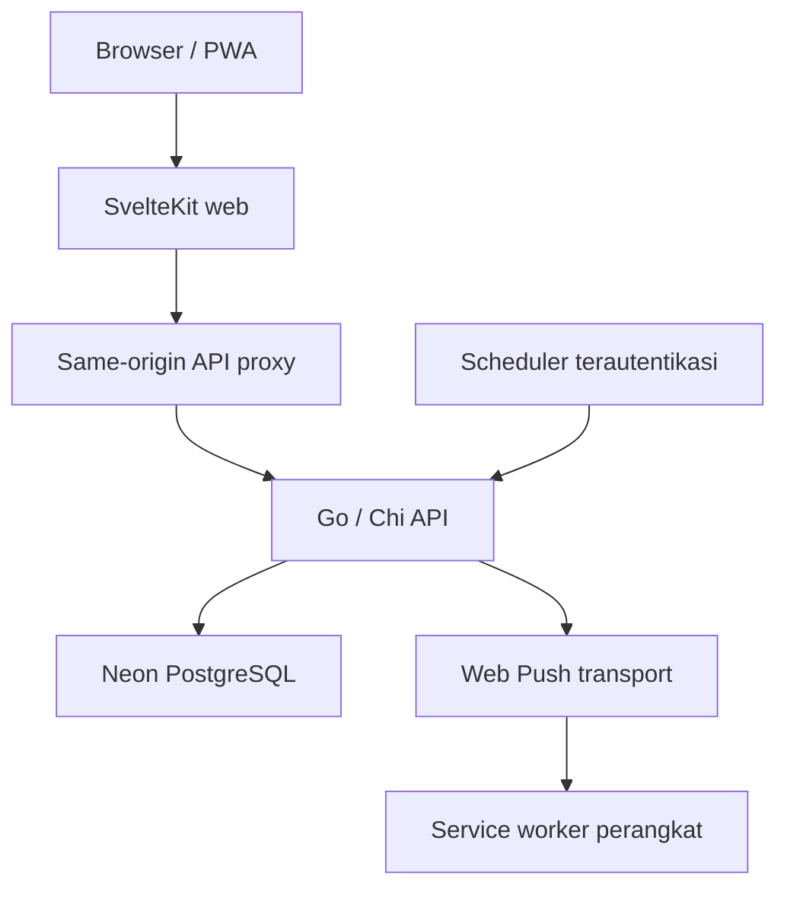
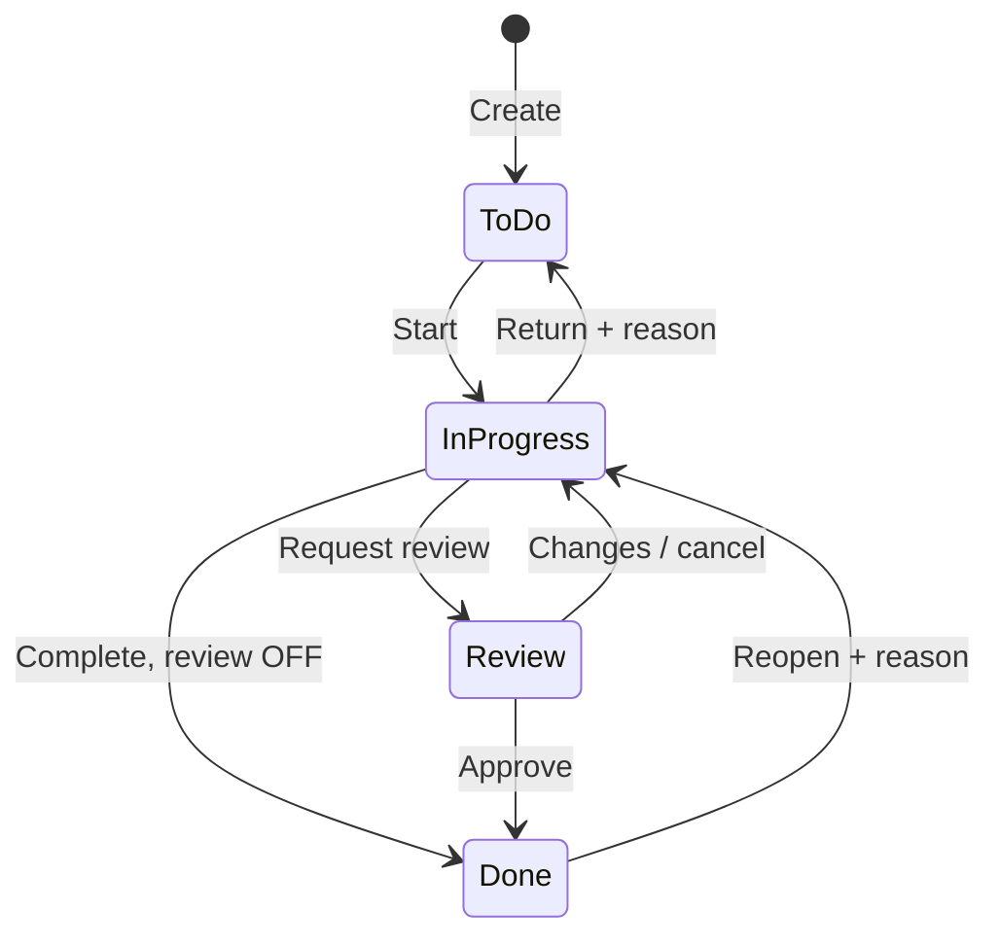

# Architecture — Unggulmart Marketing Workspace

Versi 1.1 · 29 Oktober 2026 · Lokasi: `ARCHITECTURE.md` di root repository

## Status dan sumber kebenaran

Dokumen ini menjelaskan rancangan fullstack untuk monorepo `marketing-workspace`, berdasarkan PRD v1.1 dan AGENTS.md. Struktur folder, nama helper, dan pembagian internal di bawah adalah target implementasi; bukan klaim bahwa aplikasi atau deployment sudah tersedia.

- `PRD.md` menetapkan kebutuhan, permission matrix, state machine, schema, endpoint, dan acceptance criteria.
- `AGENTS.md` menetapkan cara agent bekerja serta batas perubahan.
- `ARCHITECTURE.md` menjelaskan ownership, dependency, aliran data, dan penempatan kode.
- `openapi.yaml` menjadi kontrak HTTP saat dilengkapi pada implementasi.
- `db/migrations` menjadi riwayat schema yang dijalankan; `architecture-decisions.md` mencatat keputusan teknis dan bukti spike.

Dokumen ini tidak mengganti requirement PRD. Jika ditemukan konflik, catat dan selesaikan secara eksplisit; jangan mengubah workflow agar sesuai dengan keterbatasan library. Penjabaran teknis baru di sini adalah default implementasi yang dapat disempurnakan melalui catatan keputusan tanpa mengubah invariant produk.

## Bentuk sistem

Gunakan modular monolith: satu frontend, satu backend domain, satu PostgreSQL. Dua Vercel Projects adalah batas deployment, bukan alasan memecah domain menjadi microservices.



Browser mengirim intent pengguna dan merender state resmi API. Backend memiliki authorization, validasi, transisi task, review, kalender, jadwal reminder, inbox, serta persistence. PostgreSQL menyimpan data produk dan pekerjaan pengiriman persisten. Scheduler hanya memicu pemrosesan; scheduler tidak menyimpan aturan bisnis.

Satu tim internal dengan Supervisor dan Staff. Seluruh pengguna aktif dapat membaca pekerjaan tim; hak mutasi mengikuti hubungan creator/PIC/reviewer dan matrix PRD. Tidak ada multi-tenancy, Redis, broker, WebSocket, event sourcing, atau orchestration platform tambahan.

## Stack dan batas keputusan

| Area | Pilihan | Batas |
|---|---|---|
| Web | SvelteKit, TypeScript, Svelte 5 runes untuk setup baru | Tidak memiliki business backend kedua |
| UI | Tailwind CSS, shadcn-svelte | Komponen accessible, Bahasa Indonesia, light mode |
| Kalender | FullCalendar standard | Client lifecycle; tidak memakai premium tanpa kebutuhan |
| PWA | Plugin kompatibel; default `@vite-pwa/sveltekit` | Satu service worker; build spike M1 |
| API | Go, Chi, REST JSON | Router `http.Handler` reusable |
| Database | Neon PostgreSQL, pgx/pgxpool | SQL berparameter, transaksi eksplisit |
| Schema | Versioned SQL migrations | Runner terpisah dari runtime/build web |
| Kontrak | OpenAPI + generated TypeScript types | Tidak mengasumsikan Scramble/Laravel |
| Tooling | pnpm workspace, Go Modules, GitHub Actions | Tidak membutuhkan Nx/Turborepo |
| Deployment | Dua Vercel Projects | Go routing, cookie proxy, paket, dan runtime wajib dibuktikan |

Pilih versi stabil yang saling kompatibel pada M1 dan kunci pada lockfile/go.mod. Adapter web belum dianggap keputusan teruji: default rancangan memakai adapter Vercel yang kompatibel untuk SvelteKit dan proxy tipis bila dibutuhkan. Jangan menyalin konfigurasi `adapter-static`, `ssr=false` global, atau SPA fallback Sakala secara otomatis. FullCalendar dan browser APIs dibatasi ke client; SSR pada bagian lain tidak boleh mengakses window atau menyimpan sesi lintas request.

Dokumen ini menggunakan keputusan platform dari PRD, tanpa verifikasi ulang paket atau runtime pada penyusunan ini. Tidak ada jaminan harga, kompatibilitas, atau production readiness baru.

## Struktur repository

```text
marketing-workspace/
  AGENTS.md
  ARCHITECTURE.md
  PRD.md
  TODO.md
  SKILL.md
  WORKFLOW.md
  README.md
  package.json
  pnpm-workspace.yaml
  pnpm-lock.yaml
  .env.example
  apps/
    web/
      src/
        routes/
        lib/
          api/
            client.ts
            csrf.ts
            errors.ts
            envelope.ts
            generated/schema.d.ts
            resources/
          features/
            auth/
            dashboard/
            tasks/
            events/
            calendar/
            notifications/
            settings/
          components/
            ui/
            layout/
            feedback/
          server/
          shared/
        service-worker.ts
      static/icons/
      vite.config.ts                # SvelteKit 3 + Svelte/Vite + adapter
      vercel.json
      package.json
    api/
      api/index.go
      cmd/server/main.go
      cmd/bootstrap/main.go
      internal/
        app/
        auth/
        users/
        tasks/
        events/
        notifications/
        platform/
          db/
          httpx/
          audit/
          clock/
        testutil/
      go.mod
      go.sum
      vercel.json
  db/migrations/
  architecture-decisions.md
  openapi.yaml
  deployment.md
  runbook.md
  CALENDAR-DATA.md
  calendar-data/
  .github/workflows/
```

Ini peta penempatan, bukan kewajiban membuat semua file kosong pada M1. `src/lib/server` hanya untuk konfigurasi/proxy server yang diperlukan; jangan memasukkan query SQL, password handling, atau domain service ke sana. `shared` hanya untuk helper lintas fitur yang benar-benar digunakan, misalnya pemformatan WITA.

Seluruh dokumen Markdown, termasuk ADR, deployment, runbook, dan provenance kalender saat dibuat, berada di root. calendar-data/ hanya menyimpan asset dataset; apps/ dan db/migrations/ tetap mengikuti ownership kode/schema.

## Frontend layering

| Layer | Tanggung jawab | Tidak diletakkan di sini |
|---|---|---|
| `routes` | Page composition, layout, title, redirect ringan | HTTP convention dan aturan transisi |
| `features/<domain>` | Domain UI, form, query, mutation, refresh | Implementasi authorization final |
| `components/ui` | Primitive Button, Dialog, Badge | TaskCard, ReviewPanel |
| `components/layout` | Sidebar desktop, navigasi mobile, shell | Data source produk |
| `components/feedback` | Loading, empty, error, conflict | Parsing error network khusus endpoint |
| `api/resources` | Path endpoint dan typed request/response | Dialog dan navigasi halaman |
| `api/client.ts` | Credentials, CSRF, headers, envelope/error | Keputusan boleh approve atau complete |

Contoh feature tasks berisi `components/`, `queries.ts`, `mutations.ts`, serta `types.ts` hanya untuk tipe UI yang belum diwakili kontrak. Jangan menduplikasi DTO API secara manual. Generated types diimpor atau diberi alias langsung dari `api/generated/schema.d.ts`; file generator tidak diedit manual.

Route group `(public)` dan `(app)` boleh dipakai tanpa mengubah URL. Route produk mengikuti sitemap PRD: `/`, `/tasks`, `/tasks/[id]`, `/calendar`, `/events/[id]`, `/notifications`, dan settings. Detail task tetap memiliki URL ketika tampil sebagai drawer. `/change-password` mendukung akun dengan `must_change_password`; backend membatasi akses sampai password diganti.

Alur baca: page → feature query → API resource → HTTP client → Go API → response terstruktur → feature state → render. Raw fetch hanya berada di boundary HTTP/proxy yang ditetapkan, bukan tersebar di komponen.

### Server state dan UI state

Default awal memakai query/mutation helper feature yang sederhana; TanStack Query bukan dependency wajib. Jika pola request/cache mulai berulang, catat kebutuhan sebelum memilih library. Apa pun implementasinya, satu resource tidak memiliki cache global paralel yang saling bertentangan.

Data API adalah server state. Dialog terbuka, tab, filter draft, dan form adalah UI state dengan runes. Filter yang perlu dibagikan atau dipulihkan navigasi dapat disimpan di search params. Token sesi, data pekerjaan, dan draft sensitif tidak disimpan di localStorage. State autentikasi/server state tidak boleh menjadi singleton server yang berbagi data antar-request pengguna.

Refresh setelah mutasi, saat tab kembali aktif, dan polling paling sering sekali per 60 detik ketika visible serta online. Hentikan timer saat hidden, offline, atau unmount. Abaikan response request lama yang datang setelah filter berubah. Kegagalan refresh setelah mutasi sukses ditampilkan sebagai kegagalan pemuatan ulang; jangan mengulang mutasi dengan operation key baru.

### Forms dan mutation

Form menjalankan validasi ringan, lalu feature mutation memanggil resource. Backend tetap memvalidasi field, actor, permission, state, version, dan constraints. Feature mengelola pending, navigasi, serta refresh terkait; client mengelola konvensi HTTP.

Untuk task mutation, refresh detail/list/Kanban, dashboard, aktivitas, kalender, dan linked-event summary bila relevan. Event mutation menyegarkan event, kalender, reminder, dan dashboard. Inbox mutation menyegarkan daftar dan unread count. Tidak semua query harus di-fetch ulang untuk setiap aksi; tentukan dependency yang berubah.

HTTP 409 mempertahankan draft dan menawarkan pemuatan versi terbaru untuk dibandingkan. Jangan silent overwrite atau auto-resubmit approval. Drag Kanban memanggil endpoint aksi yang sama dengan tombol. Jika request ditolak, pulihkan posisi; tampilkan aksi review yang memerlukan reviewer/alasan melalui dialog. Tombol keyboard menjadi alternatif drag.

## Backend composition dan dependency

`internal/app` membaca config, membuka pool reusable, membuat dependency, memasang middleware/router, dan menghubungkan service. `api/index.go` mengekspor handler untuk Vercel; `cmd/server` menjalankan listener lokal dengan router yang sama. Handler serverless tidak memulai listener atau loop permanen.

| Package | Ownership |
|---|---|
| `auth` | Login, session, CSRF, password verification, middleware identitas |
| `users` | Akun/role/status, profil, pengaturan, guard Supervisor terakhir |
| `tasks` | Task, checklist, links, komentar, permissions, state machine, review rounds |
| `events` | Event, kalender read projection, linked-task summary, reminder generation |
| `notifications` | Inbox, preferensi, subscription, reminder dispatch, push delivery |
| `platform/db` | Pool, transaction plumbing, query executor dasar |
| `platform/httpx` | JSON/error helpers, request ID, HTTP convention |
| `platform/audit` | Penulisan audit tanpa rahasia dalam transaksi pemanggil |
| `platform/clock` | Clock yang dapat diganti pada test |

Setiap domain menggunakan handler, service, repository, model, dan tests sesuai kebutuhan. Handler decode HTTP dan encode hasil; service memutuskan behavior serta batas transaksi; repository menjalankan SQL. Hindari generic repository atau interface satu-per-struct.

Ketergantungan pada tabel bukan kewajiban mengimpor package service pemilik tabel. Untuk mencegah `tasks → events → tasks` atau `users → auth → users`, gunakan lookup interface kecil di package pemakai dan inject implementasinya melalui `app`. Read projection boleh menjalankan join terparameter pada tabel terkait tanpa memanggil HTTP internal. Hindari service memanggil service yang membuka transaksi baru untuk bagian mutasi yang harus atomik.

Notification writer dan audit writer menerima transaction/query executor pemanggil. Ownership notifications tidak berarti task handler harus memanggil endpoint notifikasi atau commit inbox belakangan. Shared executor ditempatkan di platform, bukan di package domain yang akan menciptakan siklus import.

### Request lifecycle

Request ID → recovery/logging → body limit/decode → autentikasi bila privat → validasi Origin/CSRF untuk unsafe browser request → service → transaksi/repository → response. Urutan detail middleware harus menjaga error JSON konsisten dan redaksi log. Login memiliki Origin check dan durable rate limit; cron memakai jalur autentikasi terpisah.

Actor berasal dari session, bukan `actor_id` atau `creator_id` klien. Decode menolak unknown fields. Handler membedakan input rusak, field invalid, forbidden, state conflict, dan dependency failure. Context cancellation/timeout diteruskan sampai SQL dan transport; jangan menampilkan stack trace atau detail SQL ke pengguna.

## Kontrak API

Gunakan inventory endpoint PRD §14; contoh di dokumen ini tidak membuat endpoint baru. Base `/api/v1`, snake_case JSON, UUID string, date `YYYY-MM-DD`, instant RFC3339 dan output UTC. API resource frontend satu-satunya tempat yang mengetahui path endpoint produk.

Detail memakai `{data}`; list memakai `{data, page:{next_cursor,has_more}}`. Error memakai `{error:{code,message,fields,request_id}}`. Cursor opaque dengan urutan stabil. Field sensitif database tidak otomatis menjadi response DTO.

| Status | Perilaku frontend |
|---|---|
| 400 / 422 | Tampilkan request/field error sesuai kontrak |
| 401 | Hapus state sesi dan arahkan login dengan relative return path aman |
| 403 | Tampilkan izin/CSRF error sesuai code; tidak dianggap logout otomatis |
| 404 | Resource tidak ditemukan |
| 409 | Tampilkan state/version/idempotency conflict; pertahankan draft |
| 429 | Hormati Retry-After |
| Network / 5xx | Tampilkan retry yang aman; jangan mengklaim save berhasil |

`expected_version` wajib pada perubahan mutable resource sesuai kontrak; DELETE child menggunakan If-Match sebagaimana PRD. Idempotency-Key UUID diperlukan pada create/aksi domain yang ditentukan PRD, bukan otomatis pada setiap request. Login/logout, password pribadi, preferences, inbox, dan subscription mengikuti pengecualian PRD.

OpenAPI dilengkapi bersama handler, termasuk security, errors, nullable fields, allowed_actions, pagination, serta limits. Generate client types melalui tool yang dipilih saat setup dan jalankan contract checks. Go tidak diasumsikan memakai generator framework tertentu. Validasi form runtime selektif boleh ditambahkan tanpa membuat salinan penuh schema backend.

## Transaksi, version, dan idempotency

Default mutasi bisnis:

1. Autentikasi actor dan validasi input dasar.
2. Cari replay operation key setelah izin baca resource terkini diverifikasi; cocokkan fingerprint method/path/canonical payload.
3. Buka transaksi, lock resource yang relevan dengan urutan konsisten, lalu cek ulang permission, active user, state, dan expected_version.
4. Ubah domain data, naikkan version/revision sesuai semantics, append history, tulis inbox serta push delivery jika ada trigger.
5. Simpan operation key/fingerprint/result reference pada activity/audit induk dan commit.
6. Kembalikan hasil commit; network push dijalankan dispatcher terpisah.

Replay diperiksa sebelum penolakan stale expected_version: aksi pertama memang sudah menaikkan version. Operation key sama dengan payload berbeda menghasilkan 409. Unique index pada ledger adalah pengaman race; bila dua request bersamaan lolos pemeriksaan awal, rollback transaksi yang kalah pada unique conflict lalu resolve replay committed secara aman. Jangan menulis ulang mutasi setelah unique conflict dalam transaksi PostgreSQL yang sudah gagal.

Ledger task dan event/admin mengikuti scope aktor + key dalam PRD. Operasi dengan beberapa activity hanya memberi operation key pada entri induk. Fingerprint memakai secret HMAC; password dan token tidak ditulis ke audit. Retry setelah timeout mempertahankan key yang sama. Audit/inbox gagal berarti mutasi domain ikut rollback.

`version` untuk optimistic concurrency; `content_revision` untuk hasil kerja yang diajukan review; `review_sequence` untuk urutan round; `reminder_revision` untuk generasi jadwal event. Jangan mengganti semuanya dengan updated_at. Komentar biasa tidak menaikkan task version/content revision sesuai PRD.

## Task dan review



Status database hanya `todo`, `in_progress`, `review`, `done`. Overdue dihitung dari deadline; archive adalah flag. Tidak ada generic PATCH status. Complete dan submit review hanya dari In Progress, oleh PIC, dengan checklist selesai jika ada.

`requires_review=false` adalah default dan tetap mengizinkan review sukarela. Direct completion mengisi `completed_by=PIC`, waktu server, method `direct`. Approval mengisi `completed_by=reviewer`, method `review-approved`. Reviewer dapat Staff atau Supervisor, tetapi harus aktif dan berbeda dari PIC/pengaju. Supervisor tidak memiliki force approve atau hak menyamar.

Request review membuat round baru dengan snapshot content_revision; partial unique index membatasi satu pending round per task. Saat Review, perubahan substantif diblokir sampai cancel; saat Done, harus reopen. Approve/Request Changes memvalidasi review_id, reviewer, snapshot, task version, dan pending status dalam transaksi. Lock task dahulu lalu round. Approve-versus-cancel hanya menghasilkan satu keputusan committed; request lain menerima conflict.

Request Changes menyimpan komentar wajib dan keputusan dalam transaksi lalu kembali In Progress. Cancel/reopen membutuhkan alasan. Reopen membersihkan completion pada task terkini, mempertahankan history dan round final. Resubmit selalu round baru. Arsip saat Review ditolak; restore mempertahankan status sebelumnya.

Authorization operasional menggunakan fungsi policy domain yang sama untuk allowed_actions dan mutasi, tetapi mutasi tetap menghitung ulang dengan state terkunci. Hak baca seluruh tim tidak memberi hak edit. Administrative override memakai actor asli dan alasan; tidak memintas state machine atau self-approval guard.

## Data dan migration boundary

Schema rinci mengikuti PRD §13; dokumen ini tidak membuat schema alternatif. Entitas utama: users/sessions; tasks dengan checklist/comments/links/reviews/activity; calendar_events/event_reminders; notifications/preferences/subscriptions/deliveries; audit_logs/auth_rate_limits/workspace_settings.

FK user dipertahankan, akun dinonaktifkan, task/event diarsipkan. Audit append-only; runtime role tidak memiliki hak mengubah/menghapus audit. Review round final dilindungi dari perubahan. Database CHECK menjaga bentuk completion, deadline union, dan all-day/timed union; service menangani invariant lintas tabel dalam transaksi.

Runtime memakai DATABASE_URL pooled dengan pool kecil reusable; default PRD MaxConns 3, MinConns 0 per instance, lalu ukur total koneksi pada concurrency serverless. Migration dan backup memakai direct URL serta role berbeda. Pool tidak dibuat ulang per request. Jangan bergantung pada state koneksi session yang tidak dijamin transaction pooling.

Migration SQL bernomor, immutable setelah diterapkan; runner terpisah memakai lock. Gunakan expand → deploy backend → deploy web → contract pada release berikutnya. PostgreSQL integration tests membuktikan constraint, rollback, lock, dan concurrency; SQLite/mock saja tidak cukup. Retensi mengikuti default PRD yang masih perlu dikonfirmasi; jangan menghapus dedup history yang masih relevan.

Ikuti staging schema PRD §13.5: completion CHECK dasar dan version/revision tersedia di M2; round serta FK komentar/notifikasi review di M3; event dan FK task/audit/notifikasi event di M4; reminder dan FK notifikasi reminder di M5. FK dibuat bersama kolom ketika tabel tujuannya tersedia, tanpa referensi bebas sementara. CHECK inbox task-only di M2 diperluas menjadi union task/event di M4. Uji upgrade antarmilestone dan rantai migration dari database kosong.

## Kalender, WITA, dan Hijriyah

Backend events memiliki read projection kalender yang menggabungkan event asli dan deadline task. Deadline tidak membuat record calendar_event. ID response `task:<uuid>` / `event:<uuid>` hanya identitas projection. Range request maksimal 93 hari; frontend mengambil rentang visible dan filter yang sama dengan API.

Instant disimpan `timestamptz`; tanggal sipil memakai `date`. Seluruh domain memakai Asia/Makassar, tanpa mengikuti timezone perangkat/host. Date-only tidak diubah menjadi Date UTC midnight. Task date-only overdue setelah akhir tanggal WITA; task timed setelah due_at. All-day end eksklusif, event timed memakai overlap rentang. FullCalendar harus terbukti merender WITA pada perangkat timezone lain; pilih dukungan timezone/library yang kompatibel lewat spike, jangan bergantung pada timezone lokal browser.

FullCalendar dibuat pada client mount dan dihancurkan saat unmount. Tombol/drag event tetap memanggil mutation tervalidasi backend. Task Done dapat tampil redup; archived tersembunyi default. Progress event dihitung dari linked task non-archived, bukan disimpan sebagai status event baru.

Provider Hijriyah berada di backend pada area kalender/events. Data awal bulan Indonesia disimpan berversi dalam calendar-data/ dengan provenance pada CALENDAR-DATA.md di root, lalu disertakan sebagai asset runtime melalui mekanisme build yang teruji, misalnya generated embedded data. Jangan mengandalkan working directory repository tersedia di function deployment.

API mengirim pemetaan harian dan metadata source/source_version/is_estimate. Jika referensi belum ada atau di luar cakupan, gunakan fallback tabular deterministik berlabel perkiraan. Frontend tidak menghitung kalender tandingan. Batas hari pemetaan adalah 00.00 WITA; kalender bukan jadwal ibadah. Update dataset tidak menggeser event Gregorian; agenda hari besar diperbarui manual mengikuti keputusan resmi.

## Reminder, inbox, dan push

Events service menghasilkan event_reminders saat event/rules berubah; notifications dispatcher memproses instance yang due. Tidak ada scheduler timer dalam browser atau goroutine sesudah response.

Default event besar H-7/H-3/H-1, kecil H-1, pukul 09.00 WITA. H-N memakai pengurangan hari kalender lokal. Penerima reminder gabungan creator/PIC aktif yang dideduplikasi. Rules kosong berarti nonaktif; waktu lewat saat create diberi skipped, bukan dikirim sekaligus.

Perubahan jadwal/PIC/rules menaikkan reminder_revision dan membatalkan pending lama dalam transaksi. Description/location tidak meregenerasi jadwal. Perubahan skala tidak menimpa custom rules tanpa pilihan eksplisit. Archive membatalkan pending dan delivery yang belum terkirim; restore hanya meregenerasi jadwal masa depan jika diminta.

### Dispatch reminder

Cron GET `/internal/cron/dispatch` memakai bearer CRON_SECRET, constant-time check, no-store, serta feature flag environment. Default PRD setiap lima menit pada paket yang mendukung, maksimal 100 kandidat dan budget kerja 20 detik yang harus berada di bawah runtime limit terverifikasi.

Lock event lalu reminder; revalidasi revision, archive, penerima aktif, dan waktu. Kandidat terkunci dilewati. Due terlambat maksimal 24 jam dan event belum mulai boleh diterbitkan sekali dengan label terlambat; selain itu skipped. Tulis inbox dengan unique dedupe key dan delivery sesuai preferensi/subscription, tandai issued, lalu commit. Race dengan reschedule mengikuti urutan lock yang sama. Notifikasi issued tetap snapshot historis; delivery lama yang belum dikirim dibatalkan.

### Persistent delivery

push_deliveries adalah outbox per subscription, bukan broker terpisah. Claim memakai SKIP LOCKED, state processing, lease token dan expiry; commit sebelum network I/O. Tulis hasil hanya jika lease token masih cocok. Reclaim lease expired memulihkan crash. Revalidasi user/session, ownership, preferensi, dan relevansi resource sebelum kirim.

Default lima percobaan total dengan retry 1/5/15/60 menit plus jitter, maksimum umur 24 jam dan tick cron aktual. Network/429/5xx dapat retry; 404/410 menonaktifkan subscription; credential/config error dicatat sebagai kegagalan operasional. Default concurrency transport 4 dengan timeout dan bounded batch.

Inbox memiliki satu logical insert per dedupe key. Provider menerima lalu worker crash masih dapat menghasilkan push ganda saat retry; tag notification_id membantu tetapi bukan jaminan exactly-once perangkat. Push gagal tidak menghapus inbox.

Hanya trigger PRD: assignment, request review, request changes, approved, event reminder. Assignment ke diri sendiri dan direct completion hanya history. Preferensi memengaruhi push, bukan inbox operasional. Perangkat baru tidak menerima backlog push lama.

## Authentication dan keamanan

Server-side session opaque token disimpan browser lewat cookie HttpOnly; hanya hash di database. Produksi memakai `__Host-um_session`, Secure, SameSite=Lax, Path=/, tanpa Domain. Default absolute tujuh hari dan idle 24 jam mengikuti PRD. Token/CSRF tidak masuk localStorage; csrf token dari login/auth/me disimpan memori dan dikirim melalui X-CSRF-Token pada unsafe request. Tidak ada Sanctum, JWT browser, OAuth, atau public registration yang diwariskan dari contoh Sakala.

Browser hanya mengakses web origin. Proxy mempertahankan method/path/query/body/status, Cookie, dan seluruh Set-Cookie secara benar; jangan menggabungkan multiple Set-Cookie dengan koma. Unsafe browser requests termasuk login memerlukan Origin allowlist yang tepat; mutasi sesi juga memerlukan CSRF. Backend publik tetap menerapkan seluruh auth dan authorization. Forwarded headers hanya dipercaya dari proxy terkonfigurasi.

Bootstrap Supervisor melalui CLI terkontrol ketika belum ada akun. Password Argon2id dengan parameter teruji pada runtime target. Reset password/role change/deactivation mencabut sesi sesuai PRD. Deaktivasi ditolak ketika tanggung jawab terbuka belum dipindahkan; guard Supervisor aktif terakhir memakai lock administrasi bersama. Recovery operasional tidak membuat endpoint publik tersembunyi.

Guard domain hadir bersama fiturnya: PIC task terbuka sejak M2, review pending sejak M3, PIC event mendatang/berlangsung sejak M4. Assignment dan deaktivasi memakai lock pengguna yang konsisten dalam transaksi; uji race saat domain terkait diperkenalkan.

Subscription push terikat user dan session; logout/revoke menonaktifkan subscription dan delivery relevan. Validasi endpoint HTTPS, provider allowlist berversi, destination network, larangan IP privat serta redirect, termasuk pada transport agar terhindar dari SSRF. Payload lockscreen generik, tanpa detail pekerjaan; click hanya membuka relative path same-origin yang valid.

SQL berparameter, unknown fields ditolak, teks dirender tanpa raw HTML, limit input/request mengikuti PRD. Rate limit login durable di PostgreSQL. Secrets, cookie, password/hash, subscription keys, serta body sensitif tidak masuk log/audit. Terapkan security headers dan no-store untuk response privat.

## PWA dan offline

Satu service worker memiliki scope root untuk asset publik dan push. Pilih satu mekanisme registrasi/build agar plugin PWA dan service-worker source tidak saling menghasilkan worker berbeda. Manifest, icon, update lifecycle, dan build diverifikasi bersama.

Cache hanya hashed assets publik, icons, dan offline page generik. API, halaman privat, inbox, serta response Set-Cookie network-only/no-store. Tidak ada offline editing, background mutation queue, atau penyimpanan pekerjaan tim dalam IndexedDB. Saat offline, blok save dan tampilkan status koneksi secara jelas.

Update worker menawarkan reload setelah form aman. Logout menghapus state klien dan cache personal jika pernah terbentuk. Feature detection dan uji perangkat membuktikan install/push; permission diminta setelah aksi pengguna. Inbox tetap tersedia saat push tidak didukung atau ditolak.

## Deployment, environment, dan operasi

Dua Vercel Projects dari satu repository: root web apps/web dan root api apps/api. Default browser `/api/v1/*` diproxy ke pasangan backend environment yang tepat. Utamakan rewrite bila terbukti menjaga semantics; jika tidak cukup, gunakan SvelteKit proxy tipis tanpa SQL/aturan produk. Health dan cron tidak perlu diteruskan dari web.

| Environment | Data | Cron/push |
|---|---|---|
| Dev | PostgreSQL lokal atau Neon dev | Fixture/manual; tanpa produksi |
| Preview/staging | Database/branch nonproduction, seed sintetis | Otomatis OFF default |
| Production | Neon production | ON setelah gate dan release berhasil |

Config gagal tertutup jika pasangan API/database environment tidak tersedia. Jangan fallback preview ke production. Bila pairing preview otomatis belum ada, gunakan pasangan staging tetap dan dokumentasikan. Secret API_ORIGIN hanya server/proxy; DB, VAPID private, CSRF/rate-limit/idempotency/cron secrets hanya backend/runner. .env.example memuat placeholder; daftar variabel normatif mengikuti PRD §21.

Release menjalankan migration kompatibel sekali dengan concurrency lock, deploy backend, deploy web, lalu health/smoke dan job activation. Auto deployment tidak boleh mendahului migration yang dibutuhkan. Rollback app tidak otomatis rollback schema; gunakan forward fix bila sesuai. Backup/restore rehearsal di database terpisah wajib sebelum produksi; target RPO/RTO dan retensi mengikuti PRD serta persetujuan operasional.

Log terstruktur menghubungkan request_id, action, status, latency, actor aman, dan job summary. Pantau error/latency, pool, cron sukses terakhir, reminder terlambat, retry/failed push, dan pemakaian provider. Alert cron tidak sukses >15 menit mengikuti default PRD; operational log tidak mengganti audit bisnis.

### Gate yang belum dibuktikan

- Catch-all Go/Chi pada Vercel: nested path, query, body, method, error, serta portable handler.
- Proxy Cookie/Set-Cookie login, auth/me, logout, password rotation, dan CSRF multi-tab.
- Adapter SvelteKit/PWA, satu worker, deep link, cache privacy, FullCalendar WITA lintas timezone.
- Versi toolchain/dependency, region, limits fungsi, monorepo migration/data asset access, dan pool concurrency.
- Paket hosting bisnis, frekuensi cron, budget/alerts, fitur restore Neon, dan perangkat push aktual.
- Sumber/cakupan Hijriyah Indonesia tervalidasi dan fallback berlabel.

Jangan menyebut hosting gratis atau production ready berdasarkan dokumen ini. Jika target Go/Vercel gagal, simpan bukti dan usulkan perubahan host melalui architecture decision; jangan mengganti stack diam-diam.

## Quality dan urutan implementasi

Ikuti tujuh milestone PRD secara berurutan; dokumen ini tidak membuat milestone tambahan. M1 membuktikan foundation dan runtime/deployment boundary sebelum fitur lanjutan. Pada setiap milestone: kontrak → migration bila diperlukan → service/policy/transaksi → handler → UI → acceptance tests → docs.

Gunakan script repository yang benar-benar tersedia. Setup awal mendefinisikan frontend format/lint, Svelte/TypeScript check, tests dan build; pnpm quality baru diwajibkan sesudah dibuat. Go menjalankan gofmt check, go vet ./..., go test ./... dari apps/api. CI menambah PostgreSQL integration, OpenAPI validation/generation drift, dan E2E kritis sesuai PRD. Jangan mengklaim checks implementasi sudah lulus saat deliverable baru dokumentasi.

Test bernilai utama: direct versus reviewed completion, review dua arah/self-approval, stale version/round, approve-cancel race, replay request timeout, rollback audit/inbox, last Supervisor/deactivation race, date-only WITA, cron overlap/reschedule, lease recovery, dan no private cache. Push otomatis memakai fake transport; pengujian perangkat memakai fixture aman. Test perubahan copy kecil cukup sebanding risikonya.

## Panduan penempatan praktis

| Kebutuhan | Lokasi |
|---|---|
| Page / layout | apps/web/src/routes |
| TaskCard, ReviewPanel, CreateEventForm | apps/web/src/lib/features/domain/components |
| Query/mutation dan refresh UI | apps/web/src/lib/features/domain |
| HTTP/CSRF/error normalization | apps/web/src/lib/api |
| Endpoint wrapper | apps/web/src/lib/api/resources |
| Generated DTO TypeScript | apps/web/src/lib/api/generated |
| Proxy server tipis | Web rewrite config atau src/lib/server + adapter route |
| Transisi/permission task | apps/api/internal/tasks |
| Kalender dan provider Hijriyah | apps/api/internal/events |
| Jadwal reminder | Events service dalam transaksi event |
| Inbox, dispatch, lease/retry push | apps/api/internal/notifications |
| Router dan dependency wiring | apps/api/internal/app |
| SQL domain | Repository domain di apps/api/internal |
| Perubahan schema | db/migrations |
| Dataset dan provenance Hijriyah | calendar-data/ + CALENDAR-DATA.md di root + asset runtime hasil build |
| Environment/deploy/restore | deployment.md dan runbook.md |
| Keputusan dengan alternatif/bukti | architecture-decisions.md |

## Anti-pattern yang harus dihindari

- Backend produk kedua dalam SvelteKit server actions atau akses database dari web.
- Raw fetch/path endpoint/parsing error tersebar di komponen.
- Cache domain ganda, sesi di localStorage, atau state pengguna global lintas request SSR.
- Circular service imports, transaksi bersarang independen, atau push network sambil menahan transaksi bisnis.
- PATCH status bebas, approval hierarkis wajib, force approve, atau completion metadata buatan klien.
- Reminder berbasis setTimeout browser, goroutine setelah response, backlog dikirim sekaligus, atau asumsi exactly-once push.
- Menyalin deadline menjadi event baru, date-only menjadi UTC midnight, atau Hijriyah tanpa provenance.
- Migration saat cold start/build web, preview memakai production, atau rollback app dianggap restore database.
- Menambah analytics, upload, recurring items, broker, multi-tenancy, atau dependency besar tanpa scope dan keputusan yang mendukung.
