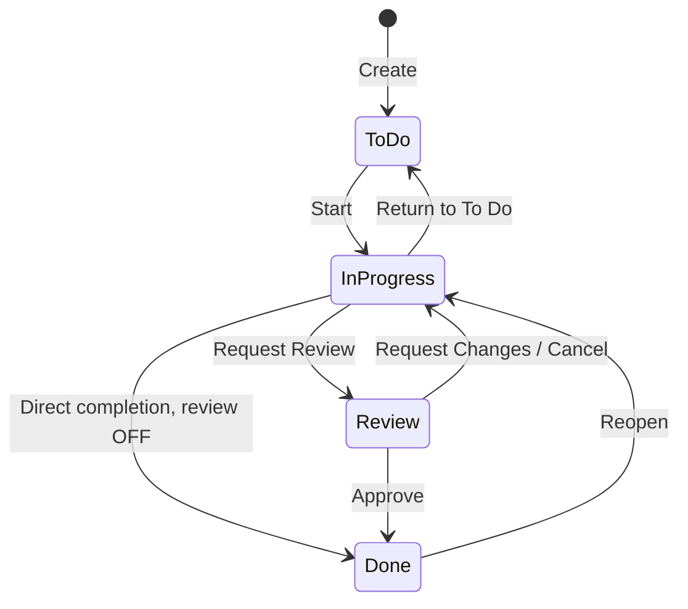

# PRD — Unggulmart Marketing Workspace

Versi: 1.1 · Diperbarui: 29 Oktober 2026 · Bahasa produk: Indonesia · Zona waktu: Asia/Makassar (WITA, UTC+08:00)

Pemilik produk: Sultan, Supervisor Marketing Unggulmart. Pengguna awal: Sultan dan Alvin. Status: spesifikasi implementasi dengan asumsi eksplisit; bukan pernyataan bahwa aplikasi atau deployment sudah dibuat.

## Cara menggunakan dokumen

Dokumen ini menjadi sumber kebutuhan produk dan aturan bisnis untuk AI coding tools. Kerjakan milestone secara berurutan. Jangan menambah modul, mengganti stack, atau menganggap contoh konfigurasi sebagai konfigurasi produksi yang sudah teruji. Implementasikan validasi bisnis di backend; frontend hanya membantu interaksi pengguna.

Seluruh dokumen Markdown proyek berada di root repository, termasuk PRD.md, ARCHITECTURE.md, AGENTS.md, TODO.md, SKILL.md, WORKFLOW.md, dan README.md. Dokumen pendukung yang dibuat kemudian juga berada di root; kontrak API berada di openapi.yaml. Kode tetap di apps/, migration di db/migrations/, dan asset data kalender di calendar-data/ dengan provenance pada CALENDAR-DATA.md di root.

Revisi 1.1 menyelaraskan lokasi dokumen sesuai permintaan pengguna, urutan migration, guard deaktivasi sejak domain tersedia, serta pelacakan pertanyaan terbuka. Default produk pada §26.1 tetap menunggu keputusan sesuai tenggatnya.

Istilah **WAJIB** menunjukkan requirement penerimaan. **Default implementasi** adalah keputusan desain yang diusulkan agar pembangunan dapat dimulai, bukan keputusan eksplisit pengguna. **Gate** harus dibuktikan sebelum milestone terkait dinyatakan selesai.

| Status keputusan | Isi |
|---|---|
| Ditetapkan oleh prompt | Stack, dua role, seluruh pekerjaan dapat dilihat tim, review dua arah, review opsional, Requires Review default OFF, empat status task, kalender ganda, WITA, PWA, push, dua Vercel Projects, dan seluruh non-goals |
| Default implementasi | Satu PIC dan satu reviewer per task; satu PIC per event; arsip sebagai penghapusan; reminder pukul 09.00 WITA; polling saat aplikasi aktif; detail kebijakan edit, sesi, retry, dan retensi dalam dokumen |
| Harus diverifikasi | Routing Go/Chi di Vercel, cookie melalui proxy, paket hosting komersial dan budget, kompatibilitas versi dependency, sumber kalender Hijriyah Indonesia, serta dukungan push perangkat aktual |

## 1. Product Overview & Goals

Unggulmart Marketing Workspace adalah aplikasi internal PWA untuk menyatukan agenda, penugasan, progres, review, dan catatan aktivitas Divisi Marketing Unggulmart di Berau. Aplikasi membantu dua pengguna mengelola pekerjaan sehari-hari melalui desktop maupun smartphone.

Tujuan produk:

1. Pengguna dapat melihat pekerjaan sendiri dan tim dari satu dashboard.
2. Pengguna dapat membuat task, menunjuk PIC, dan menyelesaikannya tanpa approval apabila review tidak diwajibkan.
3. Pengguna dapat meminta review kepada rekan kerja tanpa batasan hierarki jabatan.
4. Agenda, deadline task, dan reminder konsisten pada kalender WITA.
5. Riwayat menunjukkan siapa melakukan perubahan, kapan, dan bagaimana task diselesaikan.
6. Operasional sederhana, biaya terkendali, dan backend dapat dipindah dari Vercel tanpa menulis ulang domain logic.

Indikator penerimaan awal, bukan baseline yang sudah diukur: kedua pengguna berhasil menjalankan seluruh empat contoh workflow pada bagian 8; task baru dapat dibuat dalam ≤60 detik pada uji pengguna; tidak ada duplikasi notifikasi database dalam uji retry; seluruh transisi tidak sah ditolak. Evaluasi setelah dua minggu penggunaan melalui percakapan pengguna dan log yang tersedia, tanpa menambah modul analytics.

## 2. Problem Statement

Masalah yang hendak diselesaikan adalah agenda dan pekerjaan yang sulit dipantau bersama, ketidakjelasan PIC atau status, review yang tidak terdokumentasi, dan potensi kegiatan terlewat. Ini merupakan hipotesis kebutuhan dari prompt, bukan hasil wawancara atau klaim tentang alat kerja yang sekarang digunakan.

Approval wajib untuk semua pekerjaan akan membebani tim kecil. Sebaliknya, task yang memang membutuhkan review perlu dilindungi agar tidak selesai tanpa persetujuan reviewer yang ditunjuk. Produk harus mendukung kedua kebutuhan tanpa mencampur arti **Tandai Selesai** dan **Setujui**.

## 3. Scope & Non-Goals

### 3.1 Scope rilis awal

Authentication, akun dan role, dashboard aktivitas, task list dan Kanban, checklist, komentar, link hasil kerja, direct completion, optional review, activity history, kalender bulanan/mingguan, event besar/kecil, tanggal Hijriyah sekunder, reminder terjadwal, notification center, dan PWA dengan Web Push.

Satu workspace internal. Semua pengguna aktif dapat melihat seluruh pekerjaan tim. Tidak ada private task, multi-tenant workspace, atau pembatasan berdasarkan cabang.

### 3.2 Di luar scope

Sales/Product Analytics; Campaign Analytics; CRM/Loyalty Analytics; Basket Analysis/Cross-Selling; Competitor Intelligence; Employee Engagement Tracker; HR, payroll, attendance; time tracking; WhatsApp automation; chatbot/AI agent; integrasi Affari; integrasi Google Calendar; native mobile app; offline-first editing; modul reporting BOD khusus.

Task berjudul “Analisis penjualan Oktober” boleh dibuat, tetapi aplikasi tidak mengimpor, menghitung, atau memvisualisasikan data penjualannya.

Default pembatasan tambahan untuk menjaga scope: tidak ada upload file, recurring event, recurring task, subtasks bertingkat, dependency antar-task, multi-reviewer, email notification, chat, dan real-time WebSocket. Hasil pekerjaan ditautkan menggunakan URL. Penambahan fitur tersebut membutuhkan revisi PRD.

## 4. User Personas

| Persona | Kebutuhan utama | Contoh penggunaan |
|---|---|---|
| Sultan — Supervisor Marketing | Mengelola prioritas, agenda, pekerjaan analisis/perencanaan, kolaborasi, dan administrasi akun | Membuat task konsep event, menugaskan Alvin, meminta Alvin mereview konsep, mengelola akun |
| Alvin — Staff Marketing | Menjalankan pekerjaan operasional, melihat deadline, melaporkan hasil dan meminta/memberi review | Menyelesaikan distribusi flyer langsung; meminta review desain; mereview konsep Sultan |

Role tidak menentukan siapa wajib mereview. Creator, PIC, dan reviewer adalah hubungan terhadap pekerjaan tertentu; satu pengguna dapat memiliki hubungan berbeda pada task yang berbeda.

## 5. Roles & Permissions Matrix

### 5.1 Prinsip

Supervisor mewarisi seluruh kemampuan Staff. Hak operasional mengikuti hubungan pengguna dengan resource. Pengguna aktif tanpa hubungan edit tetap dapat membaca dan berkomentar. Backend WAJIB memeriksa identitas dari sesi, status aktif, role, hubungan resource, status task, dan versi data pada setiap mutasi.

C = creator; P = PIC; R = reviewer yang ditunjuk pada review aktif; A = Supervisor melalui aksi administrative override dengan alasan wajib. Kolom operasional berlaku identik bagi Staff dan Supervisor. Supervisor yang sudah C/P/R memakai jalur biasa.

| Aksi | Semua pengguna aktif | C | P | R | A |
|---|---|---|---|---|---|
| Lihat task/event/riwayat tim | Ya | Ya | Ya | Ya | Ya |
| Buat task/event dan pilih PIC aktif | Ya | Ya | Ya | Ya | Ya |
| Komentar pada task belum diarsipkan | Ya | Ya | Ya | Ya | Ya |
| Edit judul, deskripsi, deadline, priority, checklist, links | Tidak | Ya* | Ya* | Tidak | Ya* |
| Ganti PIC, reviewer terpilih, related event | Tidak | Ya* | Ya* | Tidak | Ya* |
| Ubah Requires Review | Tidak | Ya* | Hanya jika juga C | Tidak | Ya* |
| Start / return to To Do / direct completion | Tidak | Hanya jika juga P | Ya* | Tidak | Tidak; reassign dahulu |
| Request Review | Tidak | Hanya jika juga P | Ya* | Tidak | Tidak; reassign dahulu |
| Approve / Request Changes | Tidak | Hanya jika juga R | Tidak | Ya* | Tidak dapat menyamar sebagai R |
| Cancel review | Tidak | Ya* | Ya* | Tidak | Ya* |
| Reopen Done | Tidak | Ya* | Ya* | Tidak | Ya* |
| Arsipkan/pulihkan task | Tidak | Ya* | Ya* | Tidak | Ya* |
| Edit/arsip/pulihkan event dan reminder | Tidak | Ya | Ya | Tidak relevan | Ya |
| Preferensi dan subscription pribadi | Hanya milik sendiri | Sama | Sama | Sama | Tidak mengambil alih |
| Kelola akun, role, pengaturan admin | Tidak | Tidak | Tidak | Tidak | Ya |

`*` Tunduk pada state machine. Saat Review, perubahan substantif diblokir sampai review dibatalkan. Saat Done, perubahan substantif memerlukan reopen. Komentar tetap boleh. Arsip tidak menghapus sejarah dan tidak memintas review.

Default komentar bersifat append-only; koreksi dilakukan dengan komentar baru agar riwayat sederhana dan dapat ditelusuri. Tidak ada edit/hapus komentar oleh pengguna. Password reset dan pembatasan akun tidak boleh digunakan untuk menyamar sebagai pengguna lain.

### 5.2 Invariant izin

- Reviewer tidak boleh PIC maupun pengaju review. Creator boleh menjadi reviewer jika bukan PIC/pengaju.
- Pengguna tidak aktif tidak dapat login, menerima assignment baru, atau melakukan review.
- Pengubahan role/deaktivasi tidak boleh menghilangkan Supervisor aktif terakhir; validasi dilakukan dengan penguncian transaksi, bukan hitung terpisah tanpa lock.
- Administrative override mendukung koreksi metadata, reassign, cancel review, reopen, archive/restore; selalu mencatat alasan, aktor asli, dan sebelum/sesudah. Tidak ada `force approve` atau pemalsuan completion method.
- Tidak ada `PATCH status=done` generik. Status hanya berubah lewat endpoint aksi tervalidasi.
- Perubahan Requires Review ON → OFF wajib alasan dan audit; hanya creator atau admin. Ini perubahan kebijakan eksplisit, bukan tombol penyelesaian untuk PIC lain.

## 6. Functional Requirements

| ID | Kebutuhan | Kriteria ringkas |
|---|---|---|
| FR-AUTH-01 | Login username/email + password, logout, sesi aman | Tanpa registrasi publik; logout mencabut sesi server |
| FR-USER-01 | Supervisor membuat/mengubah akun, role, status aktif, reset password | Akun awal melalui bootstrap aman; riwayat tidak hilang saat nonaktif |
| FR-DASH-01 | Dashboard kerja pribadi/tim | Kartu dan daftar mengikuti definisi filter di bawah |
| FR-TASK-01 | CRUD task melalui create/read/update/archive | PIC wajib, reviewer opsional, Requires Review OFF |
| FR-TASK-02 | List/Kanban, pencarian, filter, checklist, komentar, link | Data kedua view berasal dari sumber sama |
| FR-TASK-03 | Direct completion | Hanya In Progress dan Requires Review OFF; dicatat `direct` |
| FR-REVIEW-01 | Review opsional dua arah | Approve/Request Changes oleh reviewer aktif yang sah |
| FR-REVIEW-02 | Cancel, revisi, resubmit, reopen, pergantian reviewer | Tidak ada approval terhadap hasil kerja yang sudah berubah |
| FR-CAL-01 | Kalender bulanan/mingguan | Event dan deadline task tanpa duplikasi record |
| FR-EVENT-01 | Event kecil/besar, PIC, kategori, lokasi, linked tasks | Default reminder sesuai skala, dapat diubah/dinonaktifkan |
| FR-HIJRI-01 | Masehi utama, Hijriyah sekunder | Sumber/metode dan keterbatasan terlihat |
| FR-NOTIF-01 | Inbox read/unread, count, timestamp, deep link | Tetap tersimpan jika push gagal |
| FR-REM-01 | Reminder terjadwal, dedup, retry, reschedule | Cron tidak bergantung pada browser aktif |
| FR-PWA-01 | Installable, responsive, offline notice | Tidak mengantre perubahan offline |
| FR-PUSH-01 | Push opt-in, VAPID, multi-perangkat | Permission diminta setelah aksi pengguna |
| FR-AUDIT-01 | Riwayat task, event, administrasi | Append-only dan konsisten dengan mutasi transaksi |

### 6.1 Dashboard dan filter

- Scope default **Tugas Saya** = `assignee_id=current_user`; **Semua Tugas** = seluruh task tim yang tidak diarsipkan.
- **To Do**, **In Progress**, **Completed** menghitung status sesuai scope; **Awaiting My Review** selalu berarti review pending yang reviewer-nya pengguna saat ini.
- **Overdue** = status bukan Done, tidak diarsipkan, dan deadline telah lewat menurut aturan bagian 17. Overdue adalah atribut turunan, bukan status kelima.
- **Upcoming Events** = event aktif yang berakhir setelah sekarang dan dimulai sebelum akhir 30 hari mendatang; event berlangsung diberi label terpisah. Urutkan berdasarkan waktu mulai.
- **Event Reminders** = reminder relevan berikutnya untuk pengguna selama tujuh hari, beserta waktu jadwal dan status. Ini tidak menambah sistem reminder kedua.
- **Recent Activities** = 20 aktivitas tim terbaru, tersedia tautan ke riwayat resource. **Quick Add** untuk task dan event.
- Badge dapat tumpang tindih: task In Progress yang terlambat masuk dua hitungan. Jangan menjumlahkan semua kartu sebagai total pekerjaan.
- Refresh setelah mutasi, saat kembali ke tab, dan polling maksimal sekali per 60 detik selama tab terlihat. Hentikan polling saat offline/hidden. Tidak ada janji real-time instan.

### 6.2 Batas input dan perilaku dasar

Judul 1–160 karakter; deskripsi maksimal 20.000; komentar/alasan maksimal 5.000; checklist 100 item/task, label 500; link 20/task, URL maksimal 2.048; reminder maksimal 10/event. Spasi saja ditolak. Validasi karakter memakai Unicode, validasi ukuran request maksimal 256 KiB.

Task: PIC wajib satu pengguna aktif; default PIC pembuat; priority `medium`; status `todo`; due date opsional; related event maksimal satu. Deskripsi berupa teks biasa dengan line breaks, tanpa HTML. Link hanya `https`/`http`, dibuka dengan `noopener noreferrer`; backend tidak mengambil preview URL.

Event: judul, deskripsi opsional, kategori, skala, waktu/tanggal, PIC wajib satu; default creator sebagai PIC; lokasi opsional maksimal 500 karakter. Kategori event: `event`, `promo`, `content`, `meeting`, `general`. `task` hanya kategori proyeksi deadline, bukan pilihan pembuatan event.

## 7. User Stories & Acceptance Criteria

| ID | User story | Acceptance criteria yang dapat diuji |
|---|---|---|
| US-01 | Sebagai pengguna, saya login aman | Kredensial valid membuat cookie HttpOnly; salah memberi pesan generik; endpoint privat tanpa sesi menghasilkan 401; logout membuat cookie lama tidak berlaku |
| US-02 | Sebagai Alvin, saya membuat task untuk Sultan | Task memiliki creator Alvin, PIC Sultan, status To Do, review OFF; Sultan menerima tepat satu notifikasi inbox |
| US-03 | Sebagai PIC, saya menyelesaikan pekerjaan rutin | Start lalu Mark as Done menghasilkan Done, completed_by PIC, timestamp server, method direct, dan activity log |
| US-04 | Sebagai PIC, saya meminta review opsional | Requires Review OFF tetap boleh Request Review; reviewer non-PIC dipilih; task menjadi Review dan direct completion ditolak selama review pending |
| US-05 | Sebagai creator, saya mewajibkan review | ON membutuhkan reviewer valid; direct completion ditolak 409; hanya approval review aktif menghasilkan Done |
| US-06 | Sebagai Alvin, saya mereview task Sultan | Alvin dapat Approve jika ditunjuk; jabatan Staff tidak menghalangi; Sultan tidak dapat approve task sendiri |
| US-07 | Sebagai reviewer, saya meminta revisi | Komentar kosong ditolak 422; komentar valid menutup putaran review sebagai changes_requested dan task kembali In Progress |
| US-08 | Sebagai PIC, saya revisi dan meminta review ulang | Putaran baru dibuat; keputusan putaran lama tetap terlihat; approval menggunakan ID putaran lama ditolak |
| US-09 | Sebagai PIC, saya memperbaiki hasil setelah submit | Cancel review dengan alasan mengembalikan In Progress; edit baru diperbolehkan; reviewer lama tidak bisa memberi keputusan pada putaran batal |
| US-10 | Sebagai creator/PIC, saya membuka kembali task | Reopen Done dengan alasan menghasilkan In Progress, membersihkan completion terkini, tetapi completion historis tetap utuh |
| US-11 | Sebagai pengguna, saya melihat tanggal kalender | Task date-only tetap tanggal WITA yang sama pada perangkat UTC; event timed tampil sesuai WITA; Hijriyah menampilkan sumber atau label perkiraan |
| US-12 | Sebagai PIC event besar, saya mendapat pengingat | Default H-7/H-3/H-1 dibuat; dua invocation cron tidak menggandakan inbox; perubahan jadwal membatalkan reminder lama yang belum dikirim |
| US-13 | Sebagai pengguna, saya menghubungkan task ke event | Detail event menunjukkan task dan persentase Done; mengganti due date mengubah proyeksi kalender tanpa membuat calendar_events baru |
| US-14 | Sebagai pengguna, saya menerima notifikasi | Trigger menghasilkan inbox walau provider push gagal; mark read hanya mengubah notifikasi milik sendiri; unread count konsisten |
| US-15 | Sebagai pengguna mobile, saya memakai PWA | Install pada perangkat kompatibel; membuka deep link menuju task yang benar setelah login; offline menampilkan pesan dan memblokir save |
| US-16 | Sebagai Supervisor, saya menonaktifkan akun | Sesi/subscription nonaktif, assignment terbuka ditangani, Supervisor aktif terakhir terlindungi, audit tersedia |
| US-17 | Sebagai pengguna, saya menyimpan saat rekan mengedit | Versi lama ditolak 409, form tetap tersedia untuk dibandingkan, tidak ada silent overwrite |
| US-18 | Sebagai pengguna tanpa hak edit, saya mencoba API langsung | Mutasi ditolak 403 walau tombol disembunyikan; membaca resource tim tetap diperbolehkan |

## 8. User Flows

### 8.1 Direct completion

Alvin membuat “Distribusi flyer” → PIC Alvin → Requires Review OFF → Mulai → checklist/link opsional diperbarui → Tandai Selesai → Done dengan method direct. Sultan menjalankan alur identik untuk task “Analisis penjualan”. Tidak ada permintaan approval tersembunyi.

### 8.2 Review dua arah

Alvin menyelesaikan desain → Minta Review → pilih Sultan → Review → Sultan Setujui → Done dengan method review-approved. Untuk konsep event, Sultan menjadi PIC dan Alvin reviewer; seluruh aturan tetap sama.

Jika reviewer meminta perubahan, komentar wajib → task kembali In Progress → PIC revisi → Minta Review kembali → putaran baru. Reviewer melihat hasil terkini dan catatan putaran sebelumnya.

### 8.3 Event dan reminder

Klik tanggal kalender → form event dengan tanggal terisi → pilih kategori/skala/PIC → periksa default reminder → simpan → event tampil → tambah task terkait → deadline task tampil mandiri. Cron membuat notifikasi sesuai jadwal; membuka notifikasi menuju detail event terbaru.

### 8.4 Login dan deep link

Pengguna membuka task dari push → jika belum login, tampil login → redirect hanya ke relative path yang telah divalidasi → buka task. Jika task diarsipkan, tampil read-only dengan label Arsip; jika tidak ditemukan, tampil 404 yang jelas. Tidak ada open redirect.

## 9. Sitemap & UI Specifications

| Route | Isi |
|---|---|
| `/login` | Identifier, password, error generik |
| `/change-password` | Ganti password pertama kali atau secara mandiri |
| `/` | Dashboard |
| `/tasks` | List/Kanban, tabs pribadi/tim/review/completed/overdue, search/filter |
| `/tasks/[id]` | Detail task shareable; dapat dibuka sebagai drawer dari list |
| `/calendar` | Monthly/weekly, navigasi, filter kategori/PIC, legend Masehi/Hijriyah |
| `/events/[id]` | Detail agenda, reminder, linked tasks, progress, riwayat |
| `/notifications` | Inbox, unread filter, tandai dibaca |
| `/settings/profile` | Profil, password, preferensi push, perangkat saat ini |
| `/settings/users` | Supervisor: akun, role, nonaktif, reset password |
| `/settings/workspace` | Supervisor: jam default reminder dan audit administrasi |

Desktop memakai sidebar; mobile memakai navigasi ringkas Dashboard, Tugas, Kalender, Notifikasi, serta menu lainnya. Modal/drawer harus punya URL detail dan tombol kembali yang konsisten. Light mode; aksen warna status tidak menjadi satu-satunya pembeda. Teks status: Belum Dimulai, Dikerjakan, Menunggu Review, Selesai. Priority: Rendah, Sedang, Tinggi.

Task detail menunjukkan creator, PIC, reviewer, review wajib/tidak, deadline WITA, checklist, links, komentar, history dan tombol yang sesuai izin. Tombol **Tandai Selesai** berbeda dari **Minta Review**; reviewer melihat **Setujui** dan **Minta Revisi**. Backend mengembalikan `allowed_actions` untuk UX; keputusan akhir tetap dihitung ulang pada mutasi.

Saat drag Kanban, hanya transisi sah diproses. Memindahkan ke Review membuka pemilih reviewer; Done memakai aksi direct atau approve sesuai peran. Jika tidak sah, kartu kembali dan pesan menjelaskan penyebab. Sediakan menu/tombol keyboard sebagai alternatif drag-and-drop.

Loading menggunakan skeleton sederhana, empty state menyertakan aksi relevan, error menyediakan retry, success berupa toast singkat. Error field ditampilkan dekat field. Dialog menjaga focus trap dan mengembalikan fokus; Escape menutup dengan peringatan jika form belum disimpan. Target WCAG 2.2 AA untuk fokus, label, kontras, navigasi keyboard, dan status screen reader. Uji mobile lebar 360 px dan desktop 1440 px; tabel boleh scroll dalam container, halaman tidak overflow horizontal.

## 10. Monorepo Architecture

Arsitektur modular monolith: frontend SvelteKit → same-origin `/api/v1/*` → proxy/rewrite → Go/Chi → PostgreSQL Neon. Cron memanggil Go untuk reminder dan push deliveries. Domain logic tidak berjalan di frontend dan database tidak dapat diakses langsung browser.

Stack WAJIB: SvelteKit + TypeScript, Tailwind CSS, shadcn-svelte, FullCalendar, plugin PWA kompatibel; Go + Chi + REST + pgx/pgxpool; Neon PostgreSQL + SQL migrations; GitHub monorepo; pnpm; Go Modules; Vercel dua project; GitHub Actions.

Default library PWA: `@vite-pwa/sveltekit`, setelah build spike dengan versi SvelteKit/Vite yang dipilih [S6]. FullCalendar memakai standard plugins saja; hindari resource timeline/premium yang tidak dibutuhkan [S5]. Integrasikan FullCalendar di client lifecycle Svelte, destroy saat unmount, dan hindari mengasumsikan wrapper Svelte tertentu tersedia atau kompatibel.

Versi dependency dipilih dari rilis stabil yang saling kompatibel saat M1, dikunci pada lockfile dan `go.mod`, lalu dicatat dalam README. PRD tidak menetapkan angka versi tanpa build aktual.

Tidak memakai microservices, Kubernetes, Redis, message broker, Nx, Turborepo, atau event sourcing. Database outbox dan polling cukup untuk dua pengguna. Reuse `http.Handler` Chi pada Vercel maupun executable Go untuk portabilitas.

## 11. Directory Structure

```text
marketing-workspace/
  apps/
    web/
      src/routes/
      src/lib/components/
      src/lib/features/{tasks,events,notifications}/
      src/lib/api/                  # typed client dari OpenAPI
      src/service-worker.ts         # satu SW: cache publik + push
      static/icons/
      vite.config.ts                # konfigurasi SvelteKit 3 + Svelte/Vite
      vercel.json
      package.json
    api/
      api/index.go                  # adapter Vercel Handler
      cmd/server/main.go            # server lokal/portable
      cmd/bootstrap/main.go         # bootstrap Supervisor, non-HTTP
      internal/app/                 # wiring router, config, dependency
      internal/auth/
      internal/users/
      internal/tasks/
      internal/events/
      internal/notifications/
      internal/platform/{db,httpx,audit,clock}/
      internal/testutil/
      go.mod
      go.sum
      vercel.json
  db/migrations/
  AGENTS.md
  ARCHITECTURE.md
  PRD.md
  TODO.md
  SKILL.md
  WORKFLOW.md
  openapi.yaml
  architecture-decisions.md
  deployment.md
  runbook.md
  CALENDAR-DATA.md                   # provenance sumber Hijriyah
  calendar-data/                     # asset dataset, bukan dokumen Markdown
  .github/workflows/{ci,release}.yml
  .env.example
  pnpm-workspace.yaml
  pnpm-lock.yaml
  package.json
  README.md
```

Nama folder dalam kurung kurawal menjelaskan direktori yang berbeda, bukan nama literal. File di atas adalah target implementasi; deliverable PRD ini belum membuat repository tersebut.

## 12. Backend Module Design

| Domain | Tanggung jawab | Dependensi yang diperbolehkan |
|---|---|---|
| auth | Login, sesi, CSRF, password, middleware identitas | users repository, DB, clock |
| users | Role, status aktif, profile, settings, last-supervisor guard | DB, auth revocation, audit |
| tasks | CRUD, permission resource, state machine, review, checklist, comments, links | DB, events lookup, notifications writer, audit |
| events | Event, kalender projection, linked-task summary, reminder generation | DB, task query, notifications writer, audit |
| notifications | Inbox, preferences, subscriptions, due reminders orchestration, push dispatcher | DB, Web Push transport, clock |

Pola per domain: `handler.go` (decode/HTTP), `service.go` (aturan bisnis/transaksi), `repository.go` (SQL), `model.go` (types), `*_test.go`. Pisahkan package ketika membantu boundary; tidak perlu interface untuk setiap struct. Interface kecil diperlukan untuk clock, push transport, dan repository yang dimock.

Mutasi penting berjalan dalam satu transaksi: lock resource → cek version/permission/state → ubah data → append history → buat inbox/outbox → commit. Kegagalan audit atau inbox membatalkan mutasi. Pengiriman network push dilakukan setelah commit oleh dispatcher, tidak sambil menahan transaksi utama.

Tidak menjalankan goroutine background yang diharapkan hidup setelah response serverless. Reuse pool per instance, bukan membuat pool untuk setiap request. Context timeout dan cancellation diteruskan ke SQL serta push transport.

## 13. Database Schema

### 13.1 Konvensi

PK bisnis `uuid` dibuat backend; `tasks.number` adalah `bigint GENERATED ... AS IDENTITY UNIQUE` untuk label `TASK-123`. Enum bisnis berupa `text` dengan CHECK agar migrasi sederhana. Semua tabel mutable memiliki `created_at`, `updated_at` bertipe `timestamptz`; record audit/history append-only cukup `created_at`. Waktu server disimpan sebagai instant UTC; date-only memakai `date`.

FK ke pengguna memakai `ON DELETE RESTRICT`; akun dinonaktifkan, tidak hard delete. Task/event menggunakan `archived_at`, `archived_by`. App database role tidak diberi UPDATE/DELETE terhadap tabel audit. Pada task_reviews, trigger menolak perubahan/hapus round yang sudah final; round pending hanya boleh diputuskan sekali. Koreksi audit dilakukan dengan entri baru. `version bigint NOT NULL DEFAULT 1` digunakan pada task/event/user/settings; update dengan optimistic concurrency serta row lock untuk transisi.

### 13.2 Entitas utama

| Tabel | Kolom inti dan aturan |
|---|---|
| `users` | id PK; username text NOT NULL; email text nullable; display_name; password_hash; role CHECK supervisor/staff; is_active bool; must_change_password bool; version; timestamps. UNIQUE lower(username), UNIQUE lower(email) WHERE email IS NOT NULL. Username tidak boleh mengandung `@`, sehingga identifier email tidak ambigu |
| `sessions` | id PK; user_id FK; token_hash bytea UNIQUE; csrf_token_hash bytea; created_at; last_seen_at; expires_at; idle_expires_at; revoked_at. Jangan menyimpan token sesi plaintext |
| `tasks` | id PK; number UNIQUE; title; description; creator_id FK; assignee_id FK NOT NULL; reviewer_id FK nullable; status CHECK todo/in_progress/review/done; priority CHECK low/medium/high; requires_review bool DEFAULT false; due_date date nullable; due_at timestamptz nullable; event_id FK nullable; content_revision bigint DEFAULT 1; review_sequence int DEFAULT 0; completed_at; completed_by FK; completion_method CHECK direct/review-approved nullable; version; archive fields; timestamps |
| `task_checklist_items` | id PK; task_id FK; label; position int; is_checked bool; checked_by FK nullable; checked_at nullable; timestamps. Unique(task_id, position), reorder dalam transaksi |
| `task_comments` | id PK; task_id FK; author_id FK; body NOT NULL; created_at; review_id FK nullable untuk komentar revisi. Tidak ada edit/hapus aplikasi |
| `task_activity_logs` | id PK; task_id FK; actor_id FK; action text; before_data jsonb; after_data jsonb; reason nullable; request_id; operation_key uuid nullable; request_fingerprint bytea nullable; result_ref jsonb nullable; created_at. Append-only; unique(actor_id, operation_key) bila terisi |
| `calendar_events` | id PK; title; description; category CHECK event/promo/content/meeting/general; scale CHECK large/small; creator_id FK; pic_id FK; location; is_all_day bool; start_date/end_date date nullable; starts_at/ends_at timestamptz nullable; reminder_revision bigint DEFAULT 1; version; archive fields; timestamps |
| `event_reminders` | id PK; event_id FK; revision bigint; rule_key text; mode CHECK days_before/absolute; days_before int nullable; local_time time nullable; absolute_at timestamptz nullable; scheduled_at timestamptz NOT NULL; status CHECK pending/issued/cancelled/skipped; issued_at nullable; cancellation_reason; timestamps. UNIQUE(event_id, revision, rule_key) |
| `notifications` | id PK; user_id FK; type CHECK task_assigned/review_requested/changes_requested/task_approved/event_reminder; actor_id FK nullable; task_id FK nullable; event_id FK nullable; review_id FK nullable; reminder_id FK nullable; dedupe_key text UNIQUE; title; body ringkas; read_at nullable; created_at. Tepat satu dari task_id/event_id terisi |
| `push_subscriptions` | id PK; user_id FK; session_id FK; endpoint text; endpoint_hash bytea UNIQUE; p256dh; auth; device_label; is_active bool; last_success_at; disabled_at; timestamps. Kunci/enpoint diperlakukan rahasia |

`tasks.due_date` dan `due_at` tidak boleh sama-sama terisi. `reviewer_id != assignee_id` jika reviewer ada. `requires_review=true` membutuhkan reviewer terpilih. Invariant lintas tabel seperti reviewer aktif dan review pending diperiksa service dalam transaksi; tidak memakai CHECK yang berisi subquery.

CHECK completion: status Done mengharuskan completed_at, completed_by, completion_method terisi; status selain Done mengharuskan ketiganya NULL. `requires_review=true AND status=done` mengharuskan method `review-approved`. Approval juga wajib cocok dengan review round approved pada transaksi tersebut.

Event all-day mengharuskan start_date dan end_date terisi, `end_date > start_date`, dan timestamps timed NULL. Event timed kebalikannya: starts_at/ends_at terisi, ends_at > starts_at, date fields NULL. Akhir all-day bersifat eksklusif.

### 13.3 Tabel tambahan yang dibutuhkan

| Tabel | Alasan dan kolom inti |
|---|---|
| `task_reviews` | Menyimpan setiap putaran review secara eksplisit: id PK, task_id FK, round int, requested_by FK, reviewer_id FK, submitted_content_revision, status CHECK pending/approved/changes_requested/cancelled, requested_at, decided_at, decided_by FK nullable, decision_comment_id FK nullable, cancellation_reason. UNIQUE(task_id, round); partial UNIQUE(task_id) WHERE status='pending' |
| `task_links` | Relasi normalized link pekerjaan: id PK, task_id FK, label, url, added_by FK, timestamps; UNIQUE(task_id, url) |
| `audit_logs` | Riwayat event dan admin yang bukan task: id PK, actor_id FK nullable untuk system job, event_id FK nullable, subject_user_id FK nullable, entity_type, action, before_data/after_data jsonb, reason, request_id, operation_key uuid nullable, request_fingerprint bytea nullable, result_ref jsonb nullable, created_at. Partial UNIQUE(actor_id, operation_key) bila terisi; rahasia selalu diredaksi |
| `notification_preferences` | Satu baris per user_id PK/FK; push_enabled default false; boolean untuk lima trigger; timestamps. Inbox operasional tetap dibuat; preferensi hanya mengatur push |
| `push_deliveries` | Retry per perangkat: id PK, notification_id FK, subscription_id FK, state CHECK pending/processing/sent/retry/failed/cancelled, attempts, next_attempt_at, lease_until, lease_token uuid, sent_at, last_error_code, timestamps; UNIQUE(notification_id, subscription_id) |
| `auth_rate_limits` | Counter bersama antar-instance: bucket_hash PK, window_started_at, failures/count, blocked_until, expires_at. Identifier/IP disimpan hash berbasis secret, bukan plaintext; TTL cleanup |
| `workspace_settings` | Singleton id CHECK id=1; default_reminder_time time DEFAULT 09:00; version; updated_by FK; timestamps. Tidak menjadi penyimpanan rahasia atau kalender timezone dinamis |

Relasi sirkular task_comments.review_id dan task_reviews.decision_comment_id ditambahkan melalui ALTER FK setelah kedua tabel dibuat. Buat review sebelum komentar keputusan; isi pointer keputusan sesudah komentar dibuat, dalam transaksi yang sama.

### 13.4 Index, transaksi, dan integritas

- `tasks(assignee_id,status,updated_at DESC)` partial non-archived; `tasks(status,due_at)` dan `(status,due_date)` partial deadline terisi/non-archived; `tasks(event_id)`; `task_reviews(reviewer_id,status)`.
- Index semua FK yang dipakai lookup; `task_activity_logs(task_id,created_at,id)`, `task_comments(task_id,created_at,id)`, `audit_logs(event_id,created_at,id)`.
- `calendar_events(starts_at,ends_at)` dan `(start_date,end_date)` partial non-archived; `(pic_id)`.
- `event_reminders(scheduled_at,id) WHERE status='pending'`; `push_deliveries(next_attempt_at,id) WHERE state IN ('pending','retry')`; index processing lease untuk recovery.
- `notifications(user_id,created_at DESC,id)` dan partial unread `WHERE read_at IS NULL`; sessions token unique + `(expires_at)`; auth rate limits expires_at.
- Pencarian awal ILIKE dengan parameter pada title/description, minimal dua karakter; tidak perlu full-text engine. Evaluasi index tambahan memakai EXPLAIN pada dataset uji, bukan menambah semuanya tanpa pengukuran.
- Approval/cancel/reassign mengunci task lebih dulu, kemudian review round, dengan urutan lock konsisten. Atomic compare version mencegah dua keputusan bersamaan.
- Deaktivasi/role mutation mengunci user terkait dan singleton settings sebagai guard administrasi; validasi Supervisor aktif terakhir dan resource terbuka dalam transaksi.
- Hard delete task/event/users tidak tersedia di API. Children dan histori tidak di-cascade-delete. Expired sessions/rate limits dan delivery lama boleh dibersihkan oleh maintenance dengan kebijakan retensi.

### 13.5 Migration dan retensi

SQL migrations bernomor berurutan, immutable setelah digunakan; gunakan satu tool migrasi seperti golang-migrate. Migration runner memakai direct database URL dan lock; aplikasi runtime memakai pooled URL [S4]. Jalankan expand → deploy backend → deploy frontend → contract pada rilis berikutnya. Jangan migrasi saat cold start fungsi atau build preview terhadap production DB.

Schema §13.2–13.4 adalah target akhir, bukan satu migration lengkap pada M1/M2. Terapkan bertahap tanpa FK menuju tabel yang belum ada:

| Milestone | Perubahan schema dan batas implementasi |
|---|---|
| M1 | Users, sessions, audit_logs, workspace_settings, auth_rate_limits. Audit administrasi belum memiliki event_id; kolom/FK tersebut ditambahkan pada M4. |
| M2 | Tasks, checklist, comments, links, activity dan inbox awal. Completion CHECK yang mewajibkan metadata lengkap saat Done dan NULL pada status lain sudah berlaku; service hanya menyediakan jalur direct. Version/content_revision tersedia sejak task dibuat. Belum ada tasks.event_id, comments.review_id, maupun notifications.event_id/review_id/reminder_id. Inbox sementara mewajibkan task_id. Preferences/subscription/delivery dapat disiapkan sebatas kebutuhan writer, tanpa mengaktifkan fitur push M6. |
| M3 | Task_reviews dan FK dua arah komentar/keputusan; tambahkan notifications.review_id. Partial unique pending round, final-round protection, dan validasi approved round melengkapi constraint completion dasar M2. |
| M4 | Calendar_events; tambahkan tasks.event_id, audit_logs.event_id, notifications.event_id beserta FK/index. Ganti CHECK inbox task-only menjadi tepat satu task_id/event_id. |
| M5 | Event_reminders dan notifications.reminder_id beserta FK/index; generation, revision dan dedup diuji. |
| M6 | Lengkapi schema preferences/subscriptions/deliveries yang belum diperlukan sebelumnya; implementasikan lifecycle dan transport push. |

Setiap milestone menguji migration dari schema milestone sebelumnya serta seluruh rantai dari database kosong pada PostgreSQL. Jangan menambahkan kolom referensi tanpa FK yang kemudian boleh diisi sembarang UUID. Kontrak/UI hanya mengekspos fitur milestone aktif; penundaan kolom tidak mengurangi invariant fitur yang sudah tersedia.

Default retensi yang perlu dikonfirmasi: histori task/event/admin selama data pekerjaan disimpan; inbox 180 hari; delivery sukses/gagal 30 hari; sesi revoked/expired 30 hari; rate limit maksimum 48 jam; log operasional 30 hari. Cleanup tidak boleh menghilangkan dedup key reminder/review historis yang masih bisa diproses ulang. Job hanya membuat notifikasi dari state pending aktif, bukan merekonstruksi history lama.

## 14. REST API / OpenAPI Specification

### 14.1 Konvensi kontrak

Base path `/api/v1`. JSON UTF-8, snake_case; UUID string; date `YYYY-MM-DD`; instant RFC3339 dengan offset saat input dan UTC saat output. Frontend menampilkan seluruh instant sebagai WITA. Response detail `{ "data": ... }`; list `{ "data": [], "page": { "next_cursor": null, "has_more": false } }`. Cursor opaque, limit default 25 maksimum 100; urutan stabil memakai timestamp + id. Search maksimal 200 karakter. Filter divalidasi allowlist, SQL order tidak diinterpolasi dari input.

Semua mutasi menggunakan CSRF header dan sesi, kecuali login dengan proteksi Origin dan cron dengan bearer secret. Resource yang mutable memakai `expected_version` (wajib pada PATCH/aksi yang menyentuh resource). Create dan aksi mutasi domain task/event/user/admin memakai `Idempotency-Key` UUID; read, login/logout, rotasi password pribadi, preferences, dan operasi inbox/subscription yang sudah idempotent tidak memerlukannya. Retry key sama dan payload sama mengembalikan hasil resource tanpa menerapkan ulang aksi; key sama dengan payload berbeda menghasilkan 409. Simpan operation_key, request fingerprint HMAC atas method/path/payload canonical, dan hasil referensi dalam entri audit mutasi; unique actor+operation_key pada ledger domain terkait dan transaksi menjamin dedup. Gunakan secret khusus fingerprint, jangan menyimpan payload password pada audit. Key berlaku per aktor dan domain ledger (task atau event/admin), termasuk method/path dalam fingerprint. Jika operasi menulis beberapa activity sekaligus, hanya entri induk membawa operation_key; entri anak memakai request_id yang sama. Periksa replay sebelum expected_version, tetapi setelah autentikasi dan izin baca resource saat ini; replay tidak boleh ditolak hanya karena mutasi pertamanya sudah menaikkan versi. Tombol retry mempertahankan key yang sama.

Error format:

```json
{
  "error": {
    "code": "INVALID_TRANSITION",
    "message": "Task yang mewajibkan review harus disetujui reviewer.",
    "fields": {},
    "request_id": "req_example"
  }
}
```

Status: 400 JSON/query rusak; 401 sesi tidak valid; 403 izin/Origin/CSRF; 404 resource tidak ada; 405 method tidak diizinkan; 409 state/version/idempotency conflict; 413 request melebihi 256 KiB; 415 Content-Type bukan JSON pada handler JSON; 422 validasi field; 429 rate limit dengan Retry-After; 503 dependensi/konfigurasi tidak tersedia atau request timeout/cancellation; 500 error internal tanpa detail SQL/stack. Create 201, read/update/aksi 200, logout/delete subscription 204. Rincian status HTTP umum ini diperjelas pada M1-02; tidak menambah endpoint atau mengubah aturan bisnis.

### 14.2 Endpoint inventory normatif

Semua path berikut relatif terhadap base path, kecuali health dan cron. Semua `:id` divalidasi UUID.

| Method & path | Request / response inti | Izin |
|---|---|---|
| POST `/auth/login` | identifier, password → user, csrf_token + Set-Cookie | Publik, rate limit + Origin |
| POST `/auth/logout` | → 204, revoke sesi + subscription terkait | Sesi + CSRF |
| GET `/auth/me` | → user, csrf_token, session expiry | Sesi |
| POST `/auth/change-password` | current_password, new_password → sesi baru | Pemilik akun; revoke sesi lama |
| GET `/users` | active filter → id/name/role/active | Semua; jangan paparkan email/hash tanpa kebutuhan |
| GET `/admin/users` | daftar admin lengkap | Supervisor |
| POST `/admin/users` | username,email?,display_name,role,temporary_password | Supervisor, Idempotency-Key |
| PATCH `/admin/users/:id` | field profil/role/is_active, expected_version | Supervisor; deactivation guard |
| POST `/admin/users/:id/reset-password` | temporary_password,expected_version | Supervisor; force change + revoke |
| GET/PATCH `/admin/settings` | default_reminder_time, expected_version | Supervisor |
| GET `/admin/audit` | filter actor/action/date, pagination | Supervisor |
| GET `/dashboard` | scope=mine/team → counts, events, reminders, activities | Semua |
| GET `/activities` | cursor, limit → gabungan activity tim yang aman | Semua |
| GET `/tasks` | scope,status,priority,assignee_id,reviewer_id,event_id,overdue,archived,q,due_from,due_to | Semua |
| POST `/tasks` | title,description?,assignee_id,reviewer_id?,requires_review?,priority?,due_date?/due_at?,event_id? | Semua; state server todo |
| GET `/tasks/:id` | → detail, version, completion, current_review, allowed_actions | Semua |
| PATCH `/tasks/:id` | metadata yang diizinkan + expected_version; reason bila perlu | C/P atau admin override |
| POST `/tasks/:id/start` | expected_version | P; todo → in_progress |
| POST `/tasks/:id/return-to-todo` | expected_version,reason | P; in_progress → todo |
| POST `/tasks/:id/complete` | expected_version | P; direct only |
| POST `/tasks/:id/request-review` | expected_version,reviewer_id | P; membuat round |
| POST `/tasks/:id/cancel-review` | expected_version,review_id,reason | C/P/A |
| POST `/tasks/:id/reviews/:review_id/approve` | expected_version | R round aktif |
| POST `/tasks/:id/reviews/:review_id/request-changes` | expected_version,comment | R round aktif |
| GET `/tasks/:id/reviews` | → seluruh round, keputusan, komentar | Semua |
| POST `/tasks/:id/reopen` | expected_version,reason | C/P/A |
| POST `/tasks/:id/archive` | expected_version,reason | C/P/A; bukan Review |
| POST `/tasks/:id/restore` | expected_version,reason | C/P/A |
| GET/POST `/tasks/:id/comments` | body; POST Idempotency-Key → comment | Semua; POST bukan archived |
| POST `/tasks/:id/checklist` | label,expected_version → item+task_version | C/P, editable state |
| PATCH `/tasks/:id/checklist/:item_id` | label?/is_checked?,expected_version | C/P, editable state |
| DELETE `/tasks/:id/checklist/:item_id` | expected_version via If-Match | C/P, editable state |
| PUT `/tasks/:id/checklist/order` | ordered_ids,expected_version | C/P; array berisi semua item tepat sekali |
| GET/POST `/tasks/:id/links` | label,url,expected_version | GET semua; POST C/P |
| DELETE `/tasks/:id/links/:link_id` | expected_version via If-Match | C/P, editable state |
| GET `/tasks/:id/activity` | cursor,limit | Semua |
| GET `/calendar` | start,end,category[],pic_id → projection+Hijri dates | Semua; rentang ≤93 hari |
| GET/POST `/events` | filter rentang/PIC; create EventInput | Semua |
| GET `/events/:id` | → event, reminders, linked tasks summary, version | Semua |
| PATCH `/events/:id` | EventPatch + expected_version | C/P/A |
| POST `/events/:id/archive` | expected_version,reason | C/P/A; cancel reminders |
| POST `/events/:id/restore` | expected_version,reason,regenerate_reminders bool | C/P/A |
| GET `/events/:id/tasks` | cursor,limit → linked tasks | Semua |
| GET `/events/:id/activity` | cursor,limit → audit event | Semua |
| PUT `/events/:id/reminders` | rules[],expected_version → reminder instances | C/P/A; [] menonaktifkan |
| GET `/notifications` | unread_only,cursor,limit | Pemilik |
| GET `/notifications/unread-count` | → count | Pemilik |
| PATCH `/notifications/:id` | is_read bool | Pemilik, idempotent |
| POST `/notifications/read-all` | through_created_at → updated_count | Pemilik, batas snapshot |
| GET/PATCH `/notification-preferences` | push_enabled + boolean trigger | Pemilik |
| GET `/push/config` | public_vapid_key, enabled | Sesi |
| POST `/push/subscriptions` | endpoint,keys,device_label → id | Pemilik; ikat sesi aktif |
| DELETE `/push/subscriptions/:id` | → 204 | Pemilik |
| GET `/healthz` | liveness tanpa rahasia | Publik, ringkas |
| GET `/readyz` | kesiapan DB tanpa detail kredensial | Monitoring terotorisasi |
| GET `/internal/cron/dispatch` | bounded batch → counts/request_id | Bearer CRON_SECRET, bukan cookie |

Admin override pada resource menggunakan endpoint biasa dan field `admin_override_reason`; backend hanya mengaktifkan bypass hubungan C/P jika aktor Supervisor. State invariant dan larangan self-approval tidak bisa dibypass. CRUD reminder digabung dalam PUT seluruh rules agar reschedule atomik. Tidak ada API edit status bebas.

### 14.3 DTO utama

`Task` mengembalikan fields schema task yang aman, user summaries, current_review, checklist summary, completion, version dan allowed_actions. `EventInput` memakai union all_day/timed, category, scale, pic_id, optional location/description dan optional reminder_rules. Jika reminder_rules tidak dikirim saat create, gunakan default skala; [] berarti sengaja nonaktif.

`ReminderRule` adalah salah satu `{mode:"days_before",days_before:7,local_time:"09:00"}` atau `{mode:"absolute",at:"2026-11-06T15:00:00+08:00"}`. Default custom dibatasi sebelum awal event, days_before 0–365; duplikat waktu efektif ditolak 422. `CalendarItem`: `{id:"task:<uuid>"|"event:<uuid>", source_type, source_id,title,start,end,all_day,category,pic,status?,url}`. ID prefix hanya projection, bukan UUID database baru.

### 14.4 OpenAPI baseline

Saat implementasi, `openapi.yaml` WAJIB mencakup seluruh endpoint inventory, request/response/error schema, security, pagination, nullable fields, batas input, serta contoh. Generate TypeScript types/client dari kontrak; CI memvalidasi spec dan mencegah drift. Berikut cuplikan valid untuk endpoint completion, bukan pengganti seluruh spec:

```yaml
openapi: 3.0.3
info:
  title: Unggulmart Marketing Workspace API
  version: 1.0.0
servers:
  - url: /api/v1
paths:
  /tasks/{id}/complete:
    post:
      operationId: completeTaskDirectly
      security:
        - SessionCookie: []
          CsrfHeader: []
      parameters:
        - in: path
          name: id
          required: true
          schema: { type: string, format: uuid }
        - in: header
          name: Idempotency-Key
          required: true
          schema: { type: string, format: uuid }
      requestBody:
        required: true
        content:
          application/json:
            schema:
              type: object
              additionalProperties: false
              required: [expected_version]
              properties:
                expected_version: { type: integer, format: int64, minimum: 1 }
      responses:
        '200':
          description: Task selesai melalui direct completion
          content:
            application/json:
              schema:
                type: object
                required: [data]
                properties:
                  data:
                    type: object
                    required: [id, status, completed_by, completed_at, completion_method, version]
                    properties:
                      id: { type: string, format: uuid }
                      status: { type: string, enum: [done] }
                      completed_by: { type: string, format: uuid }
                      completed_at: { type: string, format: date-time }
                      completion_method: { type: string, enum: [direct] }
                      version: { type: integer, format: int64 }
        '401': { description: Sesi tidak valid }
        '403': { description: Bukan PIC atau CSRF tidak valid }
        '404': { description: Task tidak ditemukan }
        '409': { description: Versi konflik atau transisi tidak sah }
        '422': { description: Input tidak valid }
components:
  securitySchemes:
    SessionCookie:
      type: apiKey
      in: cookie
      name: __Host-um_session
    CsrfHeader:
      type: apiKey
      in: header
      name: X-CSRF-Token
```

## 15. Task State Machine



| Dari | Aksi | Ke | Guard dan efek wajib |
|---|---|---|---|
| Tidak ada | create | todo | PIC aktif; review OFF default; creator dari sesi |
| todo | start | in_progress | Aktor PIC; task aktif; version sesuai |
| in_progress | return-to-todo | todo | Aktor PIC; alasan; tidak ada review pending |
| in_progress | complete | done | PIC; requires_review=false; tidak ada review pending; checklist seluruhnya checked jika ada; isi completion direct |
| in_progress | request-review | review | PIC; reviewer aktif != PIC/pengaju; checklist seluruhnya checked jika ada; buat round pending |
| review | approve | done | Reviewer round aktif; content_revision sesuai snapshot; isi completion review-approved dan completed_by reviewer |
| review | request-changes | in_progress | Reviewer round aktif; komentar nonkosong; simpan komentar dan keputusan dalam transaksi |
| review | cancel-review | in_progress | C/P/A; alasan; round cancelled; tidak ada completion |
| done | reopen | in_progress | C/P/A; alasan; clear completion terkini; preserve history |

Default checklist harus selesai untuk complete/submit review. Review pending selalu tepat satu untuk task berstatus Review dan tidak ada untuk status lain; service menjaganya atomik bersama transisi, dengan partial unique index sebagai pengaman. Link hasil kerja tidak wajib karena pekerjaan fisik dapat selesai tanpa file. Backend mengembalikan daftar item belum selesai jika ditolak. Menghapus checklist untuk memperbaiki scope dicatat di history.

Tidak ada transisi todo → done atau todo → review pada rilis awal. Pengguna harus Mulai dahulu. Tidak ada transisi review → todo/done melalui drag bebas. Archived adalah flag terpisah; semua aksi mutasi selain restore diblokir. Arsip saat Review ditolak: cancel dulu. Restore mempertahankan status terakhir; Done tetap Done, sehingga pengubahan hasil tetap membutuhkan reopen.

Perubahan status serta completion metadata harus terjadi atomik dengan activity. Waktu berasal dari server/DB, bukan timestamp klien. Response menunjukkan state final yang disimpan.

## 16. Optional Review Workflow

### 16.1 Requires Review dan pemilihan reviewer

OFF tidak melarang review; PIC boleh memilih jalur review sukarela. Reviewer yang telah dipilih pada metadata tidak otomatis membuat request. ON mewajibkan reviewer valid saat simpan dan menghilangkan opsi direct completion. Persyaratan ON tetap aktif setelah Request Changes, cancel, dan reopen.

Saat OFF namun task sedang Review, task tetap harus disetujui atau dibatalkan dulu; PIC tidak bisa menyelesaikan task dengan mengabaikan review pending. Request Review menambah `review_sequence`, mengisi round baru dan snapshot `content_revision`.

### 16.2 Menghindari approval basi

Perubahan substantif adalah judul/deskripsi, checklist, link hasil, PIC/reviewer, priority, deadline, related event, dan requires_review. Setiap perubahan menaikkan task version dan content_revision. Perubahan itu dilarang selama Review. Komentar biasa tetap boleh dan tidak mengubah snapshot hasil kerja atau task version.

Untuk mengganti hasil/reviewer saat Review: Cancel Review dengan alasan → edit metadata → Request Review baru. Putaran lama tetap cancelled. Pergantian PIC ke pengguna yang sama dengan reviewer ditolak sampai reviewer diganti/dikosongkan; jika review ON, reviewer tidak boleh kosong.

Approve dan Request Changes menerima `review_id` serta `expected_version`; backend memastikan round masih pending, actor reviewer, actor bukan PIC/pengaju, dan snapshot masih cocok. Dua aksi bersamaan: hanya satu commit, yang lain 409. Notifikasi lama tidak memberi otorisasi baru.

Reopen tidak memodifikasi keputusan review yang sudah final. Clear completed_at/by/method pada record task terkini; activity menyimpan completion sebelumnya. Review round baru diperlukan untuk menyelesaikan kembali task review wajib. Tidak mengubah approval lama menjadi direct completion.

### 16.3 Deaktivasi akun

Default: sebelum akun dengan task terbuka, event mendatang/berlangsung, atau review pending dinonaktifkan, Supervisor harus memindahkan tanggung jawab. API mengembalikan 409 `ACTIVE_RESPONSIBILITIES` beserta ringkasan resource jika belum diselesaikan. Pending review dibatalkan dahulu, kemudian reviewer diganti. Task selesai dan riwayat lama tetap menunjuk akun tersebut.

Guard diterapkan bersamaan dengan domainnya: M2 memblok deaktivasi PIC task terbuka dan menguji race deaktivasi-versus-assignment; M3 menambahkan tanggung jawab review pending; M4 menambahkan PIC event mendatang/berlangsung. Jangan menunggu M3 untuk melindungi task yang sudah tersedia di M2. Validasi assignment baru dan deaktivasi harus diserialisasi melalui lock pengguna yang konsisten agar tidak lolos bersamaan.

Deaktivasi sukses mencabut seluruh sesi, menonaktifkan subscription, dan membatalkan push belum terkirim untuk akun. Job tetap mengecek keaktifan user sebelum mengirim. Pengguna yang kehilangan akses tidak boleh menerima detail baru melalui notifikasi.

## 17. Calendar & Dual Calendar Logic

### 17.1 Kalender Gregorian dan WITA

- Zona aplikasi tetap `Asia/Makassar`, terlepas dari timezone perangkat. Gunakan database zone-aware timestamps; jangan menyimpan waktu lokal tanpa timezone sebagai instant.
- Event timed dikirim dengan offset dan disimpan `timestamptz`. Event all-day menggunakan `[start_date, end_date)`; event satu hari 7 November berarti start 7 November, end 8 November.
- Task date-only `due_date=2026-11-07` overdue mulai 8 November 00.00 WITA. Task timed overdue jika `now > due_at`. Tidak ada deadline berarti tidak overdue.
- Deadline date-only diproyeksikan sebagai all-day satu hari. Deadline timed sebagai marker pada due_at; bukan durasi pekerjaan yang direkayasa.
- Query kalender memakai overlap rentang: timed `starts_at < range_end AND ends_at > range_start`; all-day logika sama pada date. Task dipilih jika deadline berada dalam interval request. Done tetap tampil dengan gaya redup dan dapat difilter; archived tidak tampil default.
- Batas request kalender maksimum 93 hari; frontend mengambil hanya rentang visible. Week default Senin–Minggu. Filter PIC berarti assignee task atau pic event, bukan creator.
- Event progress = jumlah task Done non-archived / seluruh linked task non-archived. Jika tidak ada task, tampil “Belum ada tugas”, bukan 0% yang menyiratkan pekerjaan terlambat.
- Mengarsipkan event membatalkan reminder tetapi tidak menghapus/mengarsipkan task terkait. Task menampilkan label event diarsipkan. Tidak ada sinkronisasi status event dengan task Done.

### 17.2 Metode Hijriyah

Default desain: **calendar provider Indonesia berbasis data referensi yang diverifikasi**, dengan fallback konversi tabular berlabel perkiraan. Jangan menyatakan `islamic-umalqura` identik dengan penetapan Indonesia.

1. Pada M4, ambil Kalender Hijriah Indonesia dari sumber resmi Kementerian Agama/Bimas Islam untuk tahun yang didukung. Simpan dataset di `calendar-data/`; validasi sumber asli dan catat URL, tanggal akses, versi/hash, cakupan Gregorian serta provenance pada `CALENDAR-DATA.md` di root. Dataset memuat tanggal awal setiap bulan Hijriyah. PRD ini tidak menyertakan dataset atau mengklaim sumber tahunan tersebut sudah berhasil diunduh.
2. Backend memakai tabel referensi awal bulan dalam file berversi, bukan layanan HTTP saat request kalender. Hitung hari Hijriyah dari selisih tanggal Gregorian lokal terhadap awal bulan dalam cakupan tervalidasi. Data referensi ini tidak mengubah penyimpanan tanggal task/event.
3. Di luar cakupan atau bila dataset belum tersedia, gunakan provider tabular/civil deterministik dengan test vectors dan metadata `source=calculated`, `is_estimate=true`. UI menampilkan “Hijriyah perkiraan”; jangan diam-diam mengaku memakai kalender Kemenag. Jangan meluncurkan label “referensi Indonesia” tanpa dataset lolos QA.
4. API kalender mengembalikan `hijri_dates` berisi `gregorian_date`, `hijri_day/month/year`, `source`, `source_version`, `is_estimate`. Frontend memformat label; tidak menjalankan perhitungan berbeda yang menyebabkan mismatch SSR/client.
5. Tanggal sekunder dipetakan per hari sipil WITA mulai 00.00 untuk kebutuhan agenda. Batas hari ibadah yang dimulai saat magrib tidak dimodelkan. UI/help menjelaskan bahwa kalender ini bukan jadwal ibadah atau penetapan awal bulan resmi.
6. Untuk Ramadan, Idulfitri, dan Iduladha, agenda harus dapat diperbarui manual mengikuti keputusan resmi. Jangan menambahkan event hari besar otomatis dari konversi. Perubahan dataset tidak boleh menggeser tanggal event Gregorian yang sudah disimpan.

Jangan menerapkan offset Hijriyah global ±1 hari sebagai solusi utama; perbedaan dapat bergantung pada bulan/tahun. Implementasi provider dan cakupan data adalah gate M4, bukan alasan mengganti kalender utama menjadi Hijriyah.

## 18. Event Reminder Architecture

### 18.1 Semantik waktu dan penerima

| Jenis | Default |
|---|---|
| Event besar | H-7, H-3, H-1 pada 09.00 WITA |
| Event kecil | H-1 pada 09.00 WITA |
| Custom relatif | H-N berdasarkan tanggal mulai event di WITA, jam lokal dipilih |
| Custom absolut | Satu timestamp eksplisit sebelum awal event |
| Nonaktif | rules=[]; tidak membuat reminder pending |

H-1 berarti hari kalender sebelumnya, bukan persis 24 jam sebelum event. Untuk event 7 November 08.00 WITA, H-1 09.00 adalah 6 November 09.00 WITA. H-7 tanggal 31 Oktober dan H-3 tanggal 4 November. Jadwal pukul 09.00 WITA setara 01.00 UTC. All-day event memakai awal hari WITA sebagai batas mulai.

Penerima default: gabungan creator dan PIC aktif, dideduplikasi. Bukan seluruh tim tanpa batas. Tidak ada daftar subscriber event tambahan. Task assignment/review memiliki penerima sendiri.

Reminder yang sudah lewat saat event dibuat/disimpan diberi `skipped`, bukan dikirim sekaligus. UI menampilkan jadwal yang dilewati. Custom setelah/sama dengan awal event ditolak. Event sudah dimulai tidak menghasilkan reminder baru.

### 18.2 Perubahan event dan reminder

Perubahan start/all-day/PIC/creator recipients atau reminder rules menaikkan reminder_revision dalam transaksi, membatalkan pending lama, dan menghasilkan instances baru. Creator tidak dapat diedit melalui API biasa; kondisi disebut untuk integritas administrasi. Event description/location tidak mengubah jadwal reminder; payload mengambil detail terbaru saat dikirim.

Perubahan skala menampilkan tawaran mengganti default; backend tidak menimpa custom rules diam-diam. Jam default workspace hanya berlaku untuk event baru/default yang diterapkan ulang, bukan menggeser event existing. Arsip event membatalkan seluruh pending serta delivery reminder belum terkirim. Restore menawarkan regenerasi reminder masa depan secara eksplisit.

Reminder yang sudah issued tetap tercatat. Notifikasi lama menunjukkan jadwal pada saat dibuat dan membuka event terkini; notifikasi itu tidak dihapus. Saat reschedule, cancel delivery lama yang belum terkirim. Push yang sudah diterima perangkat tidak dapat ditarik kembali.

### 18.3 Cron dan proses atomik

Default cron setiap lima menit (`*/5 * * * *` dalam UTC) pada paket yang mendukung. Target sehat: notifikasi inbox dibuat ≤10 menit setelah scheduled_at; ini target operasi, bukan jaminan provider. Jadwal harian saja tidak memenuhi reminder custom dengan ketelitian menit. Vercel membedakan frekuensi/ketelitian cron menurut paket [S2].

1. Scheduler memanggil `/internal/cron/dispatch` dengan `Authorization: Bearer CRON_SECRET`. Endpoint menolak tanpa secret, constant-time comparison, response no-store. GET dipakai mengikuti invocation scheduler; tidak menerima cookie sebagai autentikasi alternatif.
2. Worker mengambil batch kandidat reminder due, maksimum 100; setiap transaksi mengunci event lalu reminder dengan urutan yang sama seperti mutasi event. Kandidat yang sedang terkunci dilewati, bukan ditunggu lama.
3. Periksa status pending, revision current, event aktif, penerima aktif, dan waktu. Due tetapi tertunda ≤24 jam serta event belum mulai boleh dikirim sekali dengan label terlambat; selain itu skipped. Gunakan clock DB/server konsisten.
4. INSERT notifications dengan key `event_reminder:<reminder_id>:<recipient_id>` dan `ON CONFLICT DO NOTHING`; snapshot judul/ringkasan; buat push_deliveries sesuai preferensi/subscription; update reminder issued. Semua dalam satu transaksi.
5. Commit lalu proses delivery terpisah. Jika proses berhenti sebelum commit, cron berikutnya mengulang aman; jika berhenti sesudah commit, inbox sudah tersimpan dan delivery masih bisa diklaim.
6. Batasi durasi job di bawah timeout fungsi yang terverifikasi (default budget kerja 20 detik); sisanya ditangani invocation berikutnya. Jangan bergantung pada satu invocation menyelesaikan semua antrian.

Reminder tidak dikirim ulang hanya karena cron retry. Kunci unik inbox memberikan exactly-once logical insert dalam database; transport push tetap memiliki kemungkinan duplicate delivery. Vercel cron tidak otomatis mengulang invocation gagal; tick berikutnya dan retry state aplikasi harus memulihkannya. Delivery scheduler bersifat best effort dan dapat berulang [S3].

## 19. PWA & Push Notification Architecture

### 19.1 PWA

Manifest: name “Unggulmart Marketing Workspace”, short_name “UM Marketing”, id/start_url `/`, scope `/`, display standalone, lang `id`, background/theme color, ikon 192×192 dan 512×512 serta maskable icon. Sajikan HTTPS. Integrasikan satu service worker untuk cache asset publik dan event push agar tidak ada dua SW dengan scope saling menimpa.

Cache hanya hashed JS/CSS/icons dan offline page generik. Auth API, halaman personal, response task/event, Set-Cookie, serta notification inbox memakai network-only/no-store. Jangan menyimpan data tim di Cache Storage/IndexedDB untuk editing offline. Saat offline, tampilkan halaman “Tidak ada koneksi. Hubungkan internet untuk membuka data terbaru.” Form yang belum tersimpan tidak boleh dianggap berhasil; jangan menyimpan password/draft sensitif ke localStorage.

SW update memakai prompt “Versi baru tersedia”; tunggu form aman sebelum reload. Logout membersihkan cache personal jika pernah terbentuk, state klien, dan ikatan subscription sesi. Service worker tidak membawa API secrets.

### 19.2 Trigger dan dedup

| Trigger | Penerima | Dedupe key |
|---|---|---|
| Task dibuat/di-reassign | PIC baru jika berbeda aktor | task_assigned:task_id:assignment_operation_key:recipient |
| Request Review | Reviewer round aktif | review_requested:review_id:recipient |
| Request Changes | PIC | changes_requested:review_id:recipient |
| Approved | PIC | task_approved:review_id:recipient |
| Event Reminder | Creator + PIC aktif | event_reminder:reminder_id:recipient |

Default assignment ke diri sendiri tidak menambah inbox/push, namun tetap masuk history. Direct completion hanya history. Tidak ada push untuk setiap komentar atau edit kecil. Cancel review cukup history; notifikasi review lama ditandai tidak lagi actionable saat dibuka.

Inbox adalah sumber notifikasi persisten. Push adalah saluran tambahan opt-in. Menonaktifkan push tidak menghapus inbox. Trigger dengan penerima yang sama dideduplikasi per kejadian; kejadian assignment/review baru tetap boleh menghasilkan notifikasi baru.

### 19.3 Subscription dan pengiriman

- Tampilkan status kompatibilitas browser; minta izin hanya setelah tombol “Aktifkan notifikasi” diklik. Permission denied tidak memicu prompt berulang.
- Gunakan Push API + VAPID. Public VAPID key boleh di frontend; private key hanya backend. Subscription terikat user serta sesi/browser saat registrasi. Satu user dapat memiliki beberapa subscription.
- Untuk endpoint yang sebelumnya milik akun lain pada perangkat sama, transfer ownership hanya setelah login valid dan registrasi browser aktif; batalkan delivery owner lama. Logout/session revoke menonaktifkan subscription terikat; login berikutnya dapat mengaktifkan ulang lewat proses registrasi.
- Pada iOS/iPadOS, Web Push untuk web app memerlukan aplikasi ditambahkan ke Home Screen pada versi yang mendukung; dokumentasi Apple menetapkan dukungan mulai iOS 16.4 [S7]. Feature detection tetap wajib dan perangkat aktual diuji. Inbox tetap tersedia jika push tidak didukung.
- Saat inbox dibuat, buat delivery bagi subscription aktif saat itu. Perangkat baru tidak menerima backlog push lama. Sebelum kirim, cek ulang sesi/user aktif, preferensi, ownership, serta apakah event/reminder/review masih relevan.
- Payload default generik untuk privasi lockscreen: “Ada pembaruan tugas” atau “Ada pengingat kegiatan”, notification_id dan relative URL. Detail sensitif diambil setelah sesi diverifikasi. Jangan masukkan deskripsi hasil kerja dalam payload.
- Service worker `notificationclick` memvalidasi same-origin relative path, focus/open window dan navigasi aman. Push tag berbasis notification_id membantu menggabungkan duplikasi, tetapi bukan jaminan seluruh platform.

### 19.4 Delivery retry

Dispatcher mengklaim delivery dengan `FOR UPDATE SKIP LOCKED`, menulis state processing, lease token dan lease timeout, lalu commit sebelum network I/O. Hasil hanya dapat ditulis oleh pemilik lease token terkini. Crash meninggalkan lease yang dapat diambil ulang setelah kedaluwarsa.

Default lima percobaan total, interval retry 1, 5, 15, 60 menit ditambah jitter; cron lima menit membuat waktu aktual mengikuti tick berikutnya. Network error/timeout/429/5xx retry dengan batas total umur 24 jam; hormati Retry-After yang wajar. HTTP 404/410 menonaktifkan subscription dan membatalkan delivery terkait. Kesalahan credential VAPID/4xx permanen ditandai failed dan memicu log operasional; jangan menghapus semua subscription karena salah konfigurasi server.

Set timeout network per request, concurrency kecil (default 4), dan batasi batch. Push provider menerima pesan tidak berarti pengguna sudah melihatnya. Jika provider menerima lalu worker crash sebelum update sent, retry dapat menduplikasi push. Jangan menjanjikan exactly-once pada perangkat; database notification tetap satu.

Endpoint subscription divalidasi HTTPS, host push provider yang didukung melalui allowlist terversi, larang private/loopback/link-local IP, redirect dinonaktifkan, dan batas ukuran keys. Validasi ulang destination pada transport agar subscription palsu tidak menjadi SSRF. VAPID key rotation membutuhkan rencana resubscribe perangkat.

## 20. Authentication & Security

### 20.1 Akun, password, dan sesi

Tidak ada public registration. Bootstrap Supervisor pertama melalui CLI sekali jalan dengan password dari input aman; jangan commit kredensial atau menyediakan endpoint bootstrap publik. Bootstrap hanya berhasil jika belum ada akun; gunakan transaksi/lock untuk mencegah dua bootstrap bersamaan. Akun Alvin dibuat oleh Supervisor.

Password default minimal 12 karakter, maksimal 128 Unicode code points dengan batas byte request; izinkan passphrase/spasi dan jangan truncate. Gunakan Argon2id dengan salt acak per password dan parameter tersimpan pada hash. Baseline minimum mengikuti OWASP (19 MiB, dua iterasi, parallelism satu), lalu benchmark pada runtime target [S8]. Jangan mencatat password, hash, cookie, CSRF token, VAPID private key, atau subscription keys ke log.

Login menggunakan lookup identifier case-insensitive. Pesan kegagalan sama untuk akun tidak ada, salah password, atau nonaktif. Jalankan dummy hash verification pada identifier tidak ditemukan untuk mengurangi perbedaan timing. Temporary password wajib diganti pada login pertama; sebelum itu hanya auth/me, change-password, logout tersedia.

Session opaque token acak minimal 256 bit, simpan SHA-256 hash token di DB. Cookie produksi: `__Host-um_session; Secure; HttpOnly; SameSite=Lax; Path=/` tanpa Domain. Default absolute expiry tujuh hari, idle expiry 24 jam. Perbarui last_seen/idle expiry maksimal sekali per lima menit agar write tidak berlebihan; idle expiry tidak melampaui absolute expiry. Login/password change merotasi sesi. Logout mencabut sesi dan menghapus cookie. Password reset/role change/deaktivasi mencabut semua sesi akun.

Development HTTP localhost boleh memakai nama cookie berbeda tanpa prefix __Host; konfigurasi tersebut tidak boleh aktif di production. Tidak menyimpan token auth pada localStorage.

### 20.2 CSRF, proxy, dan authorization

Same-origin proxy mempertahankan Cookie dan Set-Cookie, method, body, status, dan query. Browser hanya mengakses frontend origin. Backend mengizinkan Origin frontend tepat sesuai environment; tidak memakai `*` dengan credentials. Login pun memvalidasi Origin agar terlindung dari login CSRF.

Mutasi sesi memakai synchronizer CSRF token yang terikat sesi; kirim token lewat auth/me/login, simpan hanya dalam memori klien, cocokkan hash dengan DB. Token dapat diturunkan deterministik dari token sesi dengan HMAC server secret agar auth/me tidak merotasi token dan merusak multi-tab. Validasi Origin dan X-CSRF-Token pada POST/PATCH/PUT/DELETE. Missing Origin pada browser-mutating route ditolak; cron terpisah memakai bearer secret. CORS bukan pengganti authorization.

Percayai forwarded headers hanya dari proxy/provider yang terkonfigurasi. API deployment yang dapat dijangkau langsung tetap memerlukan sesi, CSRF, dan authorization. Jangan menganggap URL backend yang tidak diumumkan sudah aman. GET tidak mengubah data bisnis selain endpoint internal cron yang dilindungi token khusus.

### 20.3 Perlindungan aplikasi

- Semua SQL memakai parameter binding pgx; reject unknown JSON fields untuk mencegah mass assignment seperti creator_id/completed_by yang disisipkan klien.
- Escape teks UI, tidak memakai raw HTML, CSP yang sesuai asset/push origins, frame-ancestors 'none', HSTS di production, nosniff, Referrer-Policy, serta respons auth/private no-store.
- Rate limit login dibagi antar-instance melalui counter PostgreSQL atomik: baseline lima gagal per identifier per 15 menit dan 30 percobaan per IP per 15 menit; temporary cooldown 15 menit, bukan lock permanen. Endpoint reset password dan user management memakai limit lebih ketat per aktor. Hash bucket dengan secret; jangan percaya IP header buatan pengguna.
- Runtime DB role least privilege untuk tabel aplikasi; role migrasi terpisah untuk DDL. TLS database wajib; tidak hardcode DSN.
- Environment secrets berbeda untuk dev/preview/prod, tidak memakai prefix public untuk secret, tidak dikirim ke frontend bundle. Scan repository untuk secret pada CI.
- Log terstruktur berisi request_id, actor_id bila perlu, action, status, latency, dan error code. Jangan log body pekerjaan atau kredensial secara default. Audit adalah catatan bisnis; operational log bukan penggantinya.
- Tidak ada file upload, fetch preview link, atau eksekusi kode hasil input pengguna.

### 20.4 Backup, restore, dan observability

Gate production: verifikasi fitur restore/retention paket Neon yang digunakan dan lakukan restore rehearsal pada database terpisah. Default target internal RPO ≤24 jam, RTO ≤4 jam, harus disepakati dan dibuktikan lewat runbook. Jika fitur paket tidak cukup, jalankan backup terenkripsi harian memakai direct connection ke penyimpanan privat yang disetujui; jangan menyimpan dump production dalam repository/artifact publik. Biaya dan akses penyimpanan backup merupakan keputusan operasional terbuka.

Monitoring minimum: error rate/latency API, connection pool saturation, job terakhir berhasil, jumlah reminder terlambat, push retries/failed, penggunaan database/functions. Log summary cron tanpa rahasia; alarm saat cron tidak sukses >15 menit dan saat error autentikasi push meningkat. Gunakan fasilitas provider terlebih dahulu; jangan memasang stack monitoring baru tanpa kebutuhan.

## 21. CI/CD & Deployment Plan

### 21.1 Hasil verifikasi platform dan batasannya

Dokumentasi Vercel menyediakan Go runtime dengan exported handler ber-signature `http.HandlerFunc` pada direktori `/api` dan dependency melalui `go.mod` [S1]. Secara desain Chi yang mengimplementasikan `http.Handler` dapat dipasang melalui `router.ServeHTTP`. Ini dasar kelayakan, bukan bukti bahwa konfigurasi repository ini sudah berhasil di-deploy.

Gunakan dua Vercel Projects dari satu GitHub repository: web root `apps/web`, api root `apps/api`. Backend menggunakan `apps/api/api/index.go` sebagai adapter exported Handler; jangan memulai `ListenAndServe` di handler serverless. `cmd/server` memakai router yang sama untuk local/host lain.

Go routing catch-all, path preservation, paket/toolchain, batas durasi, akses folder monorepo, region, serta konfigurasi rewrite harus dibuktikan pada M1. Jangan menyalin batas runtime Node dan menganggap otomatis berlaku pada Go. Neon's pooled connection digunakan runtime; migrasi/backup memakai direct connection [S4]. Default pgxpool MaxConns 3 per instance, MinConns 0; tuning berdasarkan uji koneksi dan concurrency.

### 21.2 Same-origin dan environment

Frontend proxy `/api/v1/:path*` ke backend yang cocok environment; backend merutekan ke Chi dengan path asli. Health/internal cron tidak perlu diekspos melalui frontend. Jika external rewrite tidak memenuhi cookie/path requirement, gunakan SvelteKit server proxy tipis yang hanya meneruskan request, tanpa duplikasi aturan bisnis. Uji Set-Cookie pada response error/login/logout dan body/header forwarding.

| Environment | Frontend/backend | Database dan scheduled jobs |
|---|---|---|
| Development | SvelteKit + Go server lokal; proxy dev | PostgreSQL lokal opsional atau Neon dev; cron manual fixture |
| Preview | Dua deployment preview yang dipasangkan jelas | Neon branch/db nonproduction, data sintetis; push dan cron otomatis OFF |
| Production | Dua project production | Neon production; cron ON setelah migration/deploy terverifikasi |

Preview tidak boleh terhubung ke production DB atau production API karena env fallback. Branch preview sementara dibersihkan setelah PR ditutup. Bila otomatisasi pasangan preview belum tersedia, gunakan pasangan staging tetap terpisah production dan dokumentasikan keterbatasan; jangan diam-diam memasangkan frontend preview dengan production backend.

Environment variables minimal:

| Lokasi | Variabel |
|---|---|
| Web server | API_ORIGIN; environment marker; adapter config |
| Backend | APP_ENV; APP_ORIGIN; DATABASE_URL pooled; CSRF_SECRET; RATE_LIMIT_SECRET; IDEMPOTENCY_SECRET; CRON_SECRET; VAPID_PUBLIC_KEY; VAPID_PRIVATE_KEY; VAPID_SUBJECT; PUSH_ENABLED; CRON_ENABLED; LOG_LEVEL |
| Migration/backup runner saja | DATABASE_DIRECT_URL; credentials backup sesuai provider |
| Frontend public | Nama aplikasi dan konfigurasi publik seperlunya; public VAPID key dapat lewat `/push/config` |

`.env.example` hanya nama dan placeholder, tanpa secret asli. Timezone domain dikunci dalam kode konfigurasi `Asia/Makassar`, bukan mengikuti timezone host. Role aplikasi Sultan/Alvin tidak sama dengan seat developer/owner hosting.

### 21.3 Pipeline

Pull request: pnpm install frozen lockfile → formatting/lint → Svelte/TypeScript check → frontend unit tests → production build → gofmt check/go vet → Go unit tests → PostgreSQL integration tests/migration apply → OpenAPI lint/contract tests → Playwright alur kritis → dependency/secret scan. Gunakan path filters untuk efisiensi, tetapi perubahan OpenAPI/migration harus memicu checks kedua app.

Protected main: hanya merge setelah checks lulus. Production migrations dijalankan sekali oleh release workflow dengan concurrency lock dan environment production yang terkontrol; bukan dari setiap Vercel build. Jalankan migrasi kompatibel dahulu, deploy backend lalu frontend, health/smoke, baru aktifkan job bila ada perubahan terkait. Independent deployment berarti tiap app dapat dirilis sendiri selama kontrak backward-compatible, bukan urutan bebas ketika breaking change.

Preview boleh auto-deploy setelah checks tanpa data nyata. Production auto-deployment yang mendahului migration harus dimatikan/ditahan melalui konfigurasi release. Credential deployment dikelola sebagai secret dengan akses minimum.

Rollback: hentikan job bila mengubah data salah → rollback app ke versi kompatibel → verifikasi auth/read/write → lanjutkan job. Rollback app tidak otomatis membatalkan schema migration. Prefer forward-fix; restore DB hanya jika perlu dan setelah mempertimbangkan write setelah backup. Catat langkah, pemilik akses, dan bukti pemulihan dalam runbook.

### 21.4 Biaya dan keputusan hosting

Penggunaan ini untuk operasional bisnis. Dokumentasi Vercel Hobby membatasi penggunaan personal nonkomersial [S9]; jangan menjanjikan deployment production gratis di Hobby. Cron yang sering juga perlu paket dengan interval yang sesuai [S2]. Pertahankan target Vercel, tetapi budget paket yang sesuai merupakan gate production.

Biaya yang harus dihitung saat implementasi: paket/seat developer hosting, penggunaan function dan bandwidth, Neon compute/storage/restore, domain opsional, backup privat, dan monitoring bila berbayar. Tidak menetapkan nominal yang belum dikonfirmasi. Dua akun aplikasi tidak otomatis berarti dua seat developer hosting. Set spending alerts dan review penggunaan bulanan; polling dan cron dapat membuat database lebih sering aktif, sehingga free tier tidak boleh diasumsikan selalu cukup.

Jika gate Go/Vercel gagal secara signifikan, dokumentasikan bukti di architecture decision dan usulkan host managed yang mendukung binary/container Go dengan router sama. Perubahan host memerlukan keputusan produk; jangan mengganti Go menjadi Node tanpa dasar. VPS bukan kebutuhan default.

## 22. Testing Strategy

| Lapisan | Fokus wajib | Bukti kelulusan |
|---|---|---|
| Unit Go | Permission table, state machine, completion metadata, WITA, reminder rules/dedup, Hijri provider fixtures | Semua pasangan role/resource dan transisi sah/tidak sah diuji table-driven |
| Integrasi PostgreSQL | Constraints, transactions, concurrency, idempotency, lease recovery, migration | Menggunakan PostgreSQL sungguhan, bukan SQLite yang berbeda semantik |
| API contract | Schema, response codes, auth, CSRF, optimistic version, unknown fields | OpenAPI valid; request/response handler cocok kontrak |
| Frontend | Form validation, izin tombol, loading/error, calendar projections | Svelte checks/build lulus; tidak menyalin keputusan authorization server |
| E2E | Login/logout, direct, review kedua arah, changes/resubmit, calendar, notifications | Dua sesi pengguna terpisah dengan fixture sintetis |
| Security | IDOR, role escalation, CSRF, stored XSS, SQL injection, secret exposure, SSRF subscription | Seluruh percobaan negatif ditolak dan log tidak bocor |
| PWA/perangkat | Instalasi, SW update, offline, push/deny, logout, deep link | Uji desktop Chromium, Android Chrome, iOS Home Screen jika perangkat tersedia |
| Deploy | Go routing, cookies proxy, Neon TLS/pool, cron secret, rollback/restore | Smoke pada preview/staging dan rehearsal sebelum produksi |

Kasus wajib khusus: dua reviewer requests simultan; approve vs cancel bersamaan; cron overlap vs reschedule; worker crash setelah provider accept; ulang POST dengan idempotency key sama; perubahan deadline date-only di perangkat UTC; akhir bulan/tahun Gregorian; pergantian bulan Hijriyah; event all-day multi-hari; user nonaktif setelah inbox dibuat tetapi sebelum push dikirim; login multi-tab tanpa CSRF saling rusak.

Target performa uji, bukan SLA yang sudah terbukti: dataset 10.000 task dan 1.000 event, dua pengguna aktif; API list/dashboard p95 <1 detik pada warm path, initial usable screen ≤3 detik pada koneksi seluler uji yang dicatat; cold start dilaporkan terpisah. Mutasi tidak kehilangan update pada request bersamaan. Tidak membangun load-test suite skala besar sebelum profil awal menunjukkan kebutuhan.

Pengujian push end-to-end memakai perangkat uji nyata dan payload sintetis; automated test memakai fake push transport. Tidak mengirim notifikasi percobaan kepada akun produksi secara tak sengaja. Uji PRD bukan berarti implementasi sudah dites; semua bukti dihasilkan pada milestone pembangunan.

## 23. Edge Cases & Error Handling

| Kasus | Perilaku yang ditetapkan |
|---|---|
| Submit form dua kali/retry setelah timeout | Operation key dedup; satu mutasi dan satu logical notification |
| Dua pengguna edit task yang sama | 409 VERSION_CONFLICT, tampil data server terbaru, draft tidak diam-diam ditimpa |
| PIC mencoba approve sendiri via API | 403 SELF_APPROVAL_FORBIDDEN, tidak ada state change |
| Reviewer dipilih sama dengan PIC | 422 INVALID_REVIEWER sebelum simpan |
| Reviewer membuka notifikasi putaran lama | Detail current state; tombol keputusan tidak aktif, API 409 REVIEW_NOT_PENDING |
| Requires Review ON tanpa reviewer aktif | 422; jangan otomatis OFF |
| Dua keputusan review simultan | Lock + version; hanya satu berhasil |
| Task Done ingin diedit | 409 REOPEN_REQUIRED; komentar tetap boleh |
| Hapus event dengan linked tasks | Archive event, task tetap ada dan referensi ditandai archived |
| Restore event | Default reminder lama tidak dikirim; regenerasi future hanya jika dipilih |
| Task diarsipkan saat review | Tolak; cancel review sebelum archive |
| Deadline berubah | Satu projection berpindah; tidak insert calendar event |
| Jadwal reminder sudah lewat | Skipped pada pembuatan; catch-up runtime memakai aturan 24 jam dan sebelum event mulai |
| Cron dipanggil dua kali/overlap | Lock dan dedupe constraint; tidak menambah dua inbox |
| Event reschedule saat reminder diproses | Urutan lock event→reminder menentukan satu urutan commit; pending lama dibatalkan; revalidasi delivery sebelum send |
| Push sudah terkirim sebelum reschedule | Tidak bisa ditarik; link membuka jadwal terbaru |
| Push permission ditolak | Inbox aktif; petunjuk settings browser, tidak prompt berulang |
| Push endpoint 410 | Disable subscription, inbox tetap ada |
| Neon timeout/unavailable | 503 generik; retry read terbatas, mutasi retry dengan key yang sama |
| Sesi habis saat save | 401; minta login, jangan menampilkan sukses; draft hanya memori tab |
| Akun dinonaktifkan | Sesi revoked, push batal, history tetap menunjuk akun |
| Supervisor aktif terakhir ingin nonaktif/demote | 409 LAST_SUPERVISOR |
| Tahun Hijriyah di luar dataset | Label perkiraan, bukan data referensi resmi |
| Perangkat berbeda timezone | Tanggal/waktu tetap WITA, label timezone selalu jelas |
| User membagikan deep link | Penerima tetap login; redirect hanya internal |
| Form offline | Save diblokir/failed jelas; tidak ada queue edit tersembunyi |

## 24. Development Milestones

Jangan membuat estimasi tanggal rilis seolah kapasitas developer sudah diketahui. Setiap milestone menghasilkan increment yang bisa didemokan, kontrak/API terkait, migrasi, tests relevan, dan dokumentasi cara menjalankan. Iterasi berikutnya dimulai setelah acceptance milestone sebelumnya terpenuhi.

| Milestone | Deliverables | Acceptance criteria / exit gate |
|---|---|---|
| M1 — Foundation, database, auth | Monorepo, tooling, CI, initial migrations, bootstrap, login/logout, user management, OpenAPI baseline, deployment spike | Dua sesi role berbeda berjalan; cookie+CSRF melalui proxy diuji; preview DB terpisah; Go/Chi nested routes berjalan di Vercel; last-supervisor guard dan reset password diuji; keputusan biaya hosting dicatat |
| M2 — Task & Direct Completion | Task CRUD/archive, PIC, checklist/comments/links, list/Kanban, activity, dashboard awal | Alvin/Sultan masing-masing create→start→done; method direct benar dan completion CHECK dasar berlaku; unauthorized edits ditolak; concurrency/idempotency dan guard deaktivasi PIC task terbuka lulus; assignment inbox dibuat tanpa mensyaratkan push |
| M3 — Optional Review | Requires Review default OFF, rounds, approve/changes/cancel/reopen, reviewer change | Review Sultan→Alvin dan Alvin→Sultan; self-approval ditolak; ON tidak bisa direct; approval basi dan cancel race ditolak; history completion lama bertahan |
| M4 — Marketing & Dual Calendar | Event CRUD, FullCalendar month/week, task projection, filters, linked progress, Hijri provider | Deadline tidak duplikat; all-day/date-only/timed benar di WITA; data referensi Hijriyah punya provenance/fixtures, fallback berlabel; update Gregorian tidak dipengaruhi perubahan dataset |
| M5 — Event Reminder | Rules H-7/H-3/H-1/custom, generation, cron, inbox, reschedule/dedup | Cron nyata pada environment yang sesuai; manual staging job terotorisasi; overlap tidak duplikat; archive/reschedule membatalkan pending; catch-up dan secret tests lulus |
| M6 — PWA & Push | Manifest/icons/SW, install guidance, notification center lengkap/preferences, subscriptions/deliveries/retry | PWA dapat diinstal pada perangkat kompatibel; opt-in/denied bekerja; inbox tetap ada saat push gagal; logout mencegah delivery berikutnya; invalid subscriptions, retry, deep link dan SW update diuji |
| M7 — Hardening & Production | Security review, accessibility/performance checks, backup restore rehearsal, runbook, release workflow | Semua AC kritis lulus; paket hosting/budget dan sumber Hijriyah disepakati; production secrets terpisah; smoke/rollback berhasil; kedua pengguna menyelesaikan skenario UAT |

Inbox schema dan writer tersedia sejak M2/M3 agar mutasi domain konsisten; UI notification center lengkap dan push baru M6. Pengujian tidak ditunda seluruhnya ke M7. M7 menutup pengujian lintas fitur dan kesiapan operasional.

## 25. Definition of Done

- [ ] Semua FR dan US memiliki implementasi serta bukti acceptance yang relevan.
- [ ] Supervisor memiliki seluruh kemampuan Staff ditambah administrasi; permission diuji lewat API, bukan hanya tombol.
- [ ] Direct completion dan review-approved memiliki identitas aktor, waktu server, method berbeda, dan history yang tidak hilang saat reopen.
- [ ] Requires Review default OFF; ON tidak dapat diselesaikan langsung; tidak ada self-approval atau admin force-approve.
- [ ] Semua transisi, perubahan reviewer/PIC, archive/restore, dan perubahan kebijakan tervalidasi backend dalam transaksi.
- [ ] Kalender memakai WITA, task projection tanpa record duplikat, Gregorian sumber tanggal, Hijriyah jelas metode/cakupannya.
- [ ] Reminder/push memiliki dedup, retry, cancellation, invalid subscription handling, dan cron auth; inbox tahan terhadap kegagalan push.
- [ ] PWA installable pada target kompatibel, tidak menyimpan API privat di cache, dan tidak mengaku mendukung editing offline.
- [ ] Migrasi, OpenAPI lengkap, TypeScript client, tests, seed sintetis, env example, README, deployment dan runbook tersedia.
- [ ] CI lulus, runtime versi dikunci, tidak ada secret dalam repo/bundle/log, dan vulnerability kritis belum tertangani tidak ada.
- [ ] Dev/preview/prod terpisah, backup/restore dan rollback telah diuji, monitoring serta biaya punya pemilik.
- [ ] Tidak ada modul di luar scope atau placeholder yang ditampilkan sebagai fitur bekerja.
- [ ] UAT Sultan/Alvin diterima dan keterbatasan perangkat/hosting tercatat.

## 26. Open Questions & Technical Risks

### 26.1 Pertanyaan terbuka dengan default kerja

| ID | Keputusan yang belum dikonfirmasi | Default untuk pembangunan | Kapan harus diputuskan |
|---|---|---|---|
| OQ-01 | Budget dan pemilik akun Vercel/Neon/domain | Target Vercel tetap; jangan asumsikan Hobby boleh untuk bisnis | Sebelum production dan aktivasi cron berbayar |
| OQ-02 | Apakah satu PIC/reviewer cukup | Satu PIC dan satu reviewer/task, satu PIC/event | Sebelum M2 schema final |
| OQ-03 | Penerima reminder dan jam default | Creator+PIC, 09.00 WITA | Sebelum UAT M5 |
| OQ-04 | Bolehkah creator mematikan review wajib | Ya dengan alasan/history; PIC non-creator tidak | Sebelum UAT M3 |
| OQ-05 | Kebijakan checklist sebelum selesai/submit | Semua item checked, tanpa kewajiban link | Sebelum UAT M2 |
| OQ-06 | Sumber/tahun Hijriyah Indonesia yang akan didukung | Referensi resmi tervalidasi; fallback perkiraan | Gate M4; sumber asli belum diunduh dalam penyusunan PRD |
| OQ-07 | Perangkat/browser Sultan dan Alvin | Responsive Chromium desktop/Android; iOS diuji jika digunakan | Sebelum M6 selesai |
| OQ-08 | Retensi, backup destination, akses pemulihan | Retensi bagian 13; target RPO 24 jam/RTO 4 jam | Gate production |
| OQ-09 | Kebutuhan keterlambatan reminder yang dapat diterima | Cron 5 menit, target sehat ≤10 menit; bukan alarm presisi | Sebelum M5 production |
| OQ-10 | Kebijakan akses komentar tim | Semua user aktif boleh komentar; append-only | Sebelum UAT M2 |

Default di atas memungkinkan pembangunan tanpa memperluas scope. Jika jawaban berubah, perbarui bagian terkait, migrasi/contract/tests, serta catat keputusan. Jangan menyatakan asumsi sebagai keputusan pengguna.

TODO.md memetakan seluruh OQ ke issue keputusan dan task/gate terkait. Implementasi boleh memakai default kerja, tetapi konfirmasi yang diwajibkan pada tenggat tabel harus memiliki bukti keputusan sebelum task/gate terkait dinyatakan DONE. Pembaruan dokumen ini tidak menutup OQ apa pun.

### 26.2 Risk register

| Risiko | Dampak | Mitigasi/gate |
|---|---|---|
| Go routing/proxy tidak sesuai Vercel runtime aktual | API atau auth gagal di cloud | Spike M1 dengan handler nyata, nested path, Cookie/Set-Cookie, body, query, dan cron; simpan keputusan adapter |
| Hosting bisnis/cron memerlukan paket berbayar | Ekspektasi biaya tidak terpenuhi | Validasi ketentuan dan budget sebelum produksi; tidak mengubah stack secara diam-diam |
| Serverless/Neon cold start dan pooling | Latensi/koneksi berlebih | Pool kecil reusable, timeout, query efisien, uji cold/warm, pantau pemakaian |
| Approval terhadap versi lama | Pekerjaan yang berubah dianggap disetujui | Freeze substantive edits saat Review, round ID, revision, version check dan row locks |
| Cron/push delivery duplikat atau terlambat | Pengingat mengganggu atau terlewat | Inbox dedup, bounded retry, lease recovery, monitoring; jelaskan batas transport |
| Reschedule beradu dengan dispatch | Reminder dengan tanggal lama | Event lock/revision, batalkan pending, revalidasi sebelum push; pesan yang sudah terkirim tidak dapat ditarik |
| Konversi Hijriyah berbeda keputusan resmi | Agenda keagamaan keliru | Provenance dataset, label perkiraan, agenda resmi tetap manual Gregorian |
| PWA/push berbeda per perangkat | Pengguna tidak menerima push | Feature detection, uji perangkat, instruksi install dan inbox persisten |
| Hanya satu Supervisor kehilangan akses | Administrasi terkunci | CLI recovery terkontrol operator infrastruktur, audit, last-supervisor guard; tanpa public recovery endpoint |
| Preview terhubung ke produksi | Data nyata berubah/notification bocor | Env separation fail-closed dan synthetic seed; cron/push preview OFF |
| Auth rate limit atau push endpoint palsu | Abuse/SSRF | Counter durable, trust boundary IP, provider allowlist, TLS, no redirects, network destination validation |

### 26.3 Referensi teknis

Sumber diperiksa saat penyusunan 27 Oktober 2026. Ketentuan paket, runtime, dan kompatibilitas dapat berubah; verifikasi lagi saat implementasi. Referensi ini mendukung keputusan teknis, bukan klaim bahwa aplikasi sudah diuji. Keputusan desain spesifik seperti interval lima menit, retensi, dan model izin adalah usulan PRD.

- **[S1]** [Vercel — Go Runtime](https://vercel.com/docs/functions/runtimes/go) — exported Go handler dan go.mod sebagai dasar adapter Chi.
- **[S2]** [Vercel — Cron Usage & Pricing](https://vercel.com/docs/cron-jobs/usage-and-pricing) — perbedaan interval dan ketelitian scheduler berdasarkan paket.
- **[S3]** [Vercel — Managing Cron Jobs](https://vercel.com/docs/cron-jobs/manage-cron-jobs) — keamanan, concurrency, delivery/idempotency dan operasi cron.
- **[S4]** [Neon — Connection Pooling](https://neon.com/docs/connect/connection-pooling) — pooled runtime, direct migrations/backup, keterbatasan transaction pooling.
- **[S5]** [FullCalendar — License](https://fullcalendar.io/license) — standard MIT dan pemisahan fitur premium.
- **[S6]** [Vite PWA — SvelteKit](https://vite-pwa-org.netlify.app/frameworks/sveltekit) — integrasi PWA dengan SvelteKit; build compatibility tetap harus diuji.
- **[S7]** [Apple — Sending Web Push Notifications](https://developer.apple.com/documentation/usernotifications/sending-web-push-notifications-in-web-apps-and-browsers) — dukungan Web Push Home Screen dan batas platform.
- **[S8]** [OWASP — Password Storage Cheat Sheet](https://cheatsheetseries.owasp.org/cheatsheets/Password_Storage_Cheat_Sheet.html) — Argon2id, salt, parameter dan penyimpanan password.
- **[S9]** [Vercel — Hobby Plan](https://vercel.com/docs/plans/hobby) — batas penggunaan personal nonkomersial.

### 26.4 Instruksi eksekusi untuk AI coding tools

Mulai dengan M1 dan tulis keputusan dependency/runtime dalam architecture-decisions.md. Jangan membangun seluruh modul sekaligus. Pada setiap milestone: baca invariant terkait → lengkapi kontrak API → buat migration bila perlu → implementasikan service/permission/transaction → UI → tests dan demo acceptance → perbarui dokumentasi. Jangan mengubah workflow review, non-goals, timezone, atau completion semantics untuk mengatasi kendala UI. Jika menemukan konflik requirement, catat konflik dan usulkan penyelesaian yang paling kecil dampaknya sebelum mengubah aturan produk.

